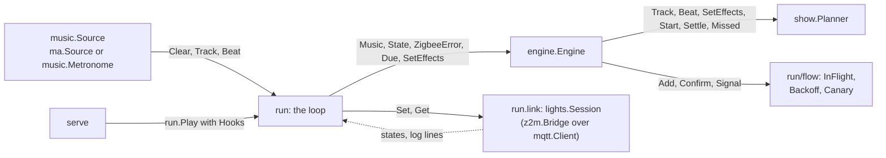

# zigbeat design

How zigbeat works and why. To use it, start with the [README](README.md).

## Contents

1. [Decisions](#decisions)
2. [Roles and fixtures](#roles-and-fixtures)
3. [Engine](#engine)
4. [Effects](#effects)
5. [Budget](#budget)
6. [Beat sources](#beat-sources)
7. [Configuration](#configuration)
8. [The probe](#the-probe)
9. [Roadmap](#roadmap)
10. [Open questions](#open-questions)
11. [Why Zigbee needs care](#why-zigbee-needs-care)
12. [Architecture](#architecture)
13. [Developing](#developing)
14. [References](#references)

## Decisions

| Decision | Reason |
|---|---|
| Existing Zigbee bulbs only; no Hue Bridge, WLED, microphone or other hardware | The point of the project |
| The pace is a number of beats, 2 by default; each moment is filled within the budget | One change per bar looked too slow on real lights. In beats, faster music never makes the lights slower, which any rounding of seconds to beats does at some tempo. The budget decides how full a moment is: colour first, then the kick, then white |
| Relays and smart plugs are never driven | Mechanical relays wear out within a few evenings, click audibly and stress LED drivers with inrush current |
| An allowlist decides what may be driven: `zigbeat setup` offers a device only when every rule holds, and run, serve and the probe check every light against the same rules | Some relay inserts, dimming plugs and dimmer modules present themselves as a light with brightness. A bulb refused wrongly is an inconvenience; a relay driven is what must never happen |
| `zigbeat setup` asks two questions and writes a file to edit; on an existing file it replaces only the lights and the canary | Picking a few lights from a list is quick; the budget, the offset and the effects stay |
| The configuration is edited in place: only the values that change move | Comments, blank lines and alignment belong to the user; no YAML library keeps them all |
| Unicast only, no Zigbee groups | Group commands are broadcasts: every router in the house repeats them and they are the first thing to saturate |
| Closed loop with a ceiling and backoff | The rest of the house always has priority |
| Network trouble pauses the show, never ends it | A party should not stop because one bulb or the broker hiccups. A pause is the deepest backoff, so the network still always wins |
| Home Assistant switches the show and its style, never its timing | Automations add too much latency and jitter for timing. The tempo comes from the beat source, not from a slider. A style change only changes what later moments pick; it sends nothing itself |
| A choice in Home Assistant stays until it is changed there; `config.yaml` is the default for what was never chosen | Every party is different, and a restart in the middle of one must not lose its style. `zigbeat run` uses only the config |
| Home Assistant keeps the choices as retained commands, one topic per setting | The broker hands them to serve on every connect. serve never publishes on them, so there is no loop and no memory of its own |
| `zigbeat serve` is a separate command; `zigbeat run` stays the one-shot CLI | The service that Home Assistant switches has a different life: it waits, plays, restores and waits again |
| serve has its own MQTT connection; each show opens its own | A stuck Home Assistant link never slows the show, and an idle serve subscribes to no light |
| serve always starts with the show off | A restart must never start a show on its own |
| The beats come from Music Assistant's own analysis, through its visualizer relay | Real beat times with downbeats, on any speaker Music Assistant plays to and from any of its providers. See [Beat sources](#beat-sources) |
| The source reports what plays as one ordered stream: tracks, with their tempo and album colours, and their beats, with their energy | A beat should not carry the properties of its track. One stream keeps the order a show relies on: a clear, then the next track, then its first beat |
| The album art's colours play vivid: hue and saturation only, greys and near-black dropped, hues 30° apart | Zigbee2MQTT sends a hex colour as xy and ignores its brightness; pale or dark colours look like a tint of white on a bulb |
| Energy is the low band of the coming bar within its track. At each bar line a bar below 0.3 starts a quiet part and a bar from 0.5 ends it: the colour changes at the next longer pace, without kicks, and the breathe lights stay low, as at backoff level 1. `effects.follow_energy` switches it off | The waveform is the raw decoded audio, before volume normalisation, so levels only compare within a track. Limited masters differ between sections below 150 Hz, hardly in the full band. On real music a breakdown measured 0, a verse 0.15 to 0.2, a pre-chorus 0.77 and a drop above 0.9; a build-up after a breakdown wavered around 0.3, hence two thresholds. The meter only knows the track so far, so an intro reads loud until something louder comes. A quiet part only takes messages away, so it never strains the network |
| The colour bulbs rotate through variants per 16 bars, with `build` at a track's start | One change at a time shows no motion; variants differ in how many bulbs change and how many colours the room shows |
| The audio offset is calibrated by ear while the show plays: typed in `zigbeat run`, or set in Home Assistant for `zigbeat serve` | One number per speaker setup. Home Assistant sets it too, so a change of speakers, such as a laptop and later the TV, needs no terminal |
| Roles and fixtures instead of device names in code | Works in any home |
| Measure first, then build | The budget shapes the effect design |
| Go, with a well-maintained library wherever it makes our code smaller: `go.yaml.in/yaml/v3`, `go-colorful`, `paho.mqtt.golang`, `x/time/rate` and `gorilla/websocket` | A single static binary; YAML is friendlier than JSON to edit by hand; colour conversion is not worth own code |
| MQTT through `eclipse/paho.mqtt.golang` (under EDL-1.0), behind `internal/mqtt`'s own small API | About 300 fewer own lines. The adapter turns off paho's reconnect (the commands dial again themselves), keeps every handler in order on one goroutine and dials the broker directly, never through `ALL_PROXY` |
| The frame budget is `golang.org/x/time/rate` | The own token bucket did the same; `AllowN` takes the loop's time, so the show still has no clock of its own |
| The Music Assistant relay through `gorilla/websocket`, behind `internal/ws`'s own small API | About 200 fewer own lines. paho links it already, so it adds almost nothing to the binary; `coder/websocket` is better maintained but made it about 650 KB bigger. A read waits for a message: pings no longer count, the time sync's answers every 10 s do |
| The image is the released binary on `gcr.io/distroless/static-debian13:nonroot`, without an init | Time zones, a non-root user and no shell to patch. Go handles SIGTERM and a second SIGINT as PID 1, and zigbeat starts no child processes, so an init adds nothing |
| A minute to stop: `stop_grace_period: 60s` in the compose example | A normal restore takes under 3 s. The drain waits up to 5 s, the lights are restored one after the other and each that does not answer takes 15 s, and a broker that went away is dialled again for 30 s: a minute covers the drain and three lights that do not answer, or the redial. Docker waits 10 s by default, and systemd kills dockerd after 90 s at a reboot, which cuts any grace period above 85 s |
| Docker compose is the one install path in the README; the release still holds the binaries, for the image and for whoever wants them | One path to document, test and support. Most Zigbee2MQTT users run it in Docker or on Home Assistant OS; the latter get a Home Assistant add-on later, see [IDEAS.md](IDEAS.md) |
| The compose example runs on the host network and mounts a directory | Home Assistant Container and Music Assistant already run on the host network, so the broker and Music Assistant are on 127.0.0.1 in any compose project. The config is saved with a rename, which fails onto a file mounted on its own |
| A pushed tag `v*` releases: GoReleaser builds the binaries, archives, checksums and the image for amd64 and arm64, on GitHub Releases and `ghcr.io/siemenvdn/zigbeat` | One tool, and the image holds exactly the released binary. ghcr.io is free for public packages, takes `GITHUB_TOKEN`, and is where Zigbee2MQTT and Music Assistant publish too |
| The version is the tag: GoReleaser stamps it, and the build info gives it after `go install …@v1.0.0` | Home Assistant shows it as `sw_version`; no build flag needed outside a release |

## Roles and fixtures

zigbeat never needs to know what your lamps are called or where they hang. Two ideas describe them.

**Roles** describe behaviour:

| Role | Needs | Does |
|---|---|---|
| `color` | Colour bulb (xy colour) | Changes colour on the beat, with a short brightness kick |
| `breathe` | Dimmable bulb | Pulses on the beat or flips between high and low |

Anything without a role is never touched. That is also how relays and plugs stay safe.

`zigbeat setup` proposes the role from Zigbee2MQTT's device list: a light with xy colour becomes `color`, any other dimmable bulb `breathe`. It offers only enabled, interviewed routers with a native definition and exactly one light on one channel, with settable state and brightness, without switch, cover, fan, lock or climate parts, power metering, in-wall settings or a description that reads like a plug, relay, dimmer or module; Tuya datapoint lights are left out too. `zigbeat run`, `serve` and `probe` check every light against the same rules before anything changes.

**Fixtures** group bulbs that physically belong together, like a pendant with three bulbs. Effects can move per bulb or per fixture, which looks very different in a room.

## Engine

| Part | Job |
|---|---|
| `music.Source` | One ordered stream of what plays, at least 1 s ahead: a track with its tempo and album colours, its beats with their energy, and a clear when they no longer apply. Music Assistant is the source when the config has it, else a fixed-BPM metronome. See [Beat sources](#beat-sources). |
| Planner | Decides per moment which bulbs change and how: the variant, the colour, the brightness kick, the breathe variant, within the room the budget gives the moment. See [Effects](#effects). |
| Scheduler | Sends each message early by its number of Zigbee frames times the measured latency per frame, plus a configurable audio offset for TV and amplifier delay, which `zigbeat run` and Home Assistant can change while it plays. The estimate starts at `budget.latency_ms` and follows the median of the last 20 confirmations. A colour change, a white jump or a flip that cannot leave within 150 ms of its send time is dropped on its own, so a `together` fixture can miss one bulb for a moment; returns and falls are never dropped. Due messages for one bulb are merged. |
| Rate limiter | Token bucket in Zigbee frames at `budget.max_rate`, holding one full moment (9 frames: three kicks and three white messages): `golang.org/x/time/rate`, fed the loop's time. A hard ceiling, never a target. Colour plus brightness in one message is two frames. |
| Closed loop | At most one message in flight per bulb and six in total: one moment's colour and white. A message is confirmed by the bulb's next state. Unanswered after 5 s counts as lost. |
| Backoff | Level 0 normal, 1 no kick, breathe bulbs still and one message in flight, 2 pause: nothing is sent but canary reads. Signals: latency per frame of the queue a message joined above twice the show's own starting median, a lost message, a slow canary, a Zigbee2MQTT error. One step per 10 s at most; one step back after a quiet minute. Errors about other devices raise it to 1 at most. |
| Robustness | A bulb that misses twice in a row is left alone and read once a minute until it answers. A lost broker connection is dialled again every 5 s. Bulbs that do not answer at the start are left out, and a Zigbee2MQTT group name in the config is refused. A panic stops the show and restores every light. |
| Snapshot | Reads the state of every configured bulb at start and restores it at stop, one bulb at a time within the budget. A bulb that was off first gets its level and colour back, then goes off, so it does not come on in the show's colour next time. A broker that drops during the restore is dialled again for 30 s. |
| Home Assistant | `zigbeat serve`: MQTT device discovery with a switch, the style of the show and sensors, availability through a will. See [Home Assistant](#home-assistant). |

The latency signal is relative to the show itself, not to the probe: a moment sends up to six messages at once, they queue at the coordinator, and the show settles at about twice the probe's evenly spaced latency. How many leave together changes per phrase, so the signal divides each latency by the frames in flight when the message left, its own included: a busier moment is not a slower network. The send-early estimate and the status line keep the latency per frame of the message itself.

### The status line

`zigbeat run` prints one every 10 s; `zigbeat serve` publishes the same numbers as sensors:

```
21:14:10  moments 35  dropped 2  frames/s 4.2  in flight 1  p50 38 ms  backoff 0  canary 61 ms  z2m err 0
```

| Field | Meaning |
|---|---|
| `moments` | Moments played so far |
| `dropped` | Colour changes skipped because they could not land on the beat, per light |
| `frames/s` | Zigbee frames sent, always below `budget.max_rate` |
| `in flight` | Messages waiting for their confirmation |
| `p50` | Time until Zigbee2MQTT confirms, per frame |
| `backoff` | 0 normal, 1 no kick, 2 paused |
| `canary`, `z2m err` | Last canary answer and Zigbee2MQTT errors so far |

At the start, `zigbeat run` prints the state of every light as JSON after `current state (for manual restore)`, for the case it cannot put them back itself. Ctrl-C, `kill` or a closed SSH session stops the show and restores every light, lights that were off included. A second Ctrl-C quits at once without restoring.


### Home Assistant

| Topic | Retained | Payload |
|---|---|---|
| `homeassistant/device/zigbeat/config` | yes | Device discovery: the switch, eight style entities and six sensors in one message |
| `zigbeat/availability` | yes | `online` after connecting; `offline` on a clean stop and as the MQTT will |
| `zigbeat/state` | yes | One JSON object for every entity; the numbers are `null` (unknown) while the show does not play, the style is always there |
| `zigbeat/show/set` | no | `ON` or `OFF` from the switch |
| `zigbeat/style/<key>/set` | yes, by Home Assistant | A choice for `effects.<key>`: `album_palette` (`ON`, `OFF`), `album_colors`, `variant`, `brightness`, `pace` (`every beat` to `every 4 bars`), `breathe_variant`, `breathe_low` or `breathe_high` (one end of `breathe_range`), `follow_energy` (`ON`, `OFF`), or for `budget.audio_offset_ms` (`audio_offset_ms`); empty is no choice |

- A kept choice for a setting that is gone, such as `cadence`, the pace in seconds of an older zigbeat, gets a line with the command that wipes it.
- On every connect serve clears a retained switch command first, subscribes to the switch and to the style topics, whose retained choices arrive as commands, then publishes `online`, the discovery message and the last state. A broker restart drops the connection, so this also covers a broker that lost its retained messages; Home Assistant's birth message is not needed.
- Each show calls back every 10 s with its numbers. The callback only stores the newest state; a separate goroutine publishes it, so Home Assistant stays out of the timing path.
- `OFF` cancels the show, which restores every light exactly as on Ctrl-C. An `ON` that arrives during the restore starts the next show right after it.
- A style command is checked like the config (`config.Effects.Validate`): a refused one gets a line and changes nothing, an empty one gives the key back to the config. The style in force goes into the next show's config and, through `run.Hooks.Effects`, into a running one, from its next moment. A kept choice that arrives again after a reconnect changes nothing.

#### Entities

| Entity | Shows |
|---|---|
| `switch.zigbeat_show` | Starts and stops the show |
| `sensor.zigbeat_status` | `off`, `starting`, `running`, `paused` or `stopping` |
| `sensor.zigbeat_frames_per_second` | Zigbee frames sent, always below `budget.max_rate` |
| `sensor.zigbeat_latency` | Time until Zigbee2MQTT confirms, per frame |
| `sensor.zigbeat_backoff` | 0 normal, 1 no kick, 2 paused |
| `sensor.zigbeat_lights_playing`, `sensor.zigbeat_lights_left_alone` | Lights in the show, and lights from the config that do not answer |

The numbers follow every 10 s and are unknown while the show is off. When zigbeat stops or loses its connection, the entities become unavailable.

The style, set before the show starts or while it plays; a change applies from the next moment:

| Entity | Sets | In the config |
|---|---|---|
| `switch.zigbeat_album_colours` | Whether the album art's colours play | `effects.album_palette` |
| `number.zigbeat_album_colour_count` | How many colours, 2 to 6 | `effects.album_colors` |
| `select.zigbeat_variant` | How the colour bulbs change: `rotation`, `walk`, `shuffle`, `swap` or `build` | `effects.variant` |
| `number.zigbeat_brightness` | The base brightness of the colour bulbs, 1 to 100 % | `effects.brightness` |
| `select.zigbeat_pace` | How often the bulbs change: every beat, every 2 beats, every bar, every 2 bars or every 4 bars | `effects.pace` |
| `select.zigbeat_breathe_variant` | How the breathe bulbs move: `rotation`, `pulse` or `flip` | `effects.breathe_variant` |
| `number.zigbeat_breathe_low` | The low end of the breathe bulbs, 1 to 100 % | `effects.breathe_range` |
| `number.zigbeat_breathe_high` | The high end of the breathe bulbs, 1 to 100 %, above the low end | `effects.breathe_range` |
| `switch.zigbeat_follow_energy` | Whether quiet parts of the music play calmer | `effects.follow_energy` |
| `number.zigbeat_audio_offset` | How much later than the beat the lights change, for the delay of TV and speakers: -500 to 2000 ms, in steps of 10 | `budget.audio_offset_ms` |

A pace that the budget cannot carry at the tempo that plays gets slower only when even the colour changes without kicks do not fit; the show prints a line when that happens.

A choice stays until it is changed in Home Assistant, also when zigbeat or Home Assistant restarts: the broker keeps it, and over its own restart too when it has persistence, as Home Assistant's Mosquitto app does. What was never chosen comes from `config.yaml`; editing a key there that was chosen in Home Assistant changes nothing until the choice is wiped. `zigbeat run` uses only `config.yaml`. To give one setting back to the config, wipe its choice, for example the brightness:

```bash
mosquitto_pub -r -n -t zigbeat/style/brightness/set
```

Run one `zigbeat serve` per broker, and no `zigbeat run` while its show is on. To remove the device from Home Assistant, stop zigbeat and clear its discovery message and the choices:

```bash
mosquitto_pub -r -n -t homeassistant/device/zigbeat/config
for k in album_palette album_colors variant brightness pace breathe_variant breathe_low breathe_high follow_energy audio_offset_ms cadence; do mosquitto_pub -r -n -t zigbeat/style/$k/set; done
```

## Effects

### Pace

A moment falls every `effects.pace` beats: 1, 2, 4, 8 or 16, every 2 by default. From 4 beats on that is the first beat of a bar. A beat is a moment when its number is a multiple of the interval, so moments stay on the grid when the pace or the tempo changes, and a pickup beat before a new track's first downbeat is a moment only on that track's grid.

| Tempo | Every 2 beats |
|---|---|
| 90 BPM | 1.33 s |
| 120 BPM | 1.00 s |
| 124 BPM | 0.97 s |
| 174 BPM | 0.69 s |

Faster music never makes the lights slower. A pace in seconds, rounded to powers of two beats, would: at some tempo the next power always lasts longer.

**The room of a moment** is `budget.max_rate`, less the canary's reads, times the interval, in Zigbee frames counted like the rate limiter counts them. A moment is filled in this order until the room is used, and what does not fit is not planned:

1. the colour changes the variant picks, at most three, 1 frame each;
2. their kicks, all or none: 2 more frames each, for the brightness and the return;
3. white: a pulse 2 frames, a flip 1, for at most three breathe bulbs, taking turns.

Only when the colour changes without kicks do not fit does the interval double, with a note, up to 16 beats. The kick's return and the pulse's fall land half the interval later, at most a beat.

### `color` bulbs

- **Variants:** what changes at a moment, at most three messages:

  | Variant | Who changes | The room |
  |---|---|---|
  | `walk` | About half the bulbs, in config order from where the last moment stopped | Many colours, travelling |
  | `shuffle` | As many, in a shuffled order; every bulb once before any comes back | Many colours, no pattern |
  | `swap` | One of two groups dealt round-robin (more groups when one would hold more than three bulbs); the groups take turns, each in one colour | Two colours, like a checkerboard |
  | `build` | One bulb, to a shared target colour; when every bulb shows it, the next colour | Fills slowly with one colour |

- **Rotation** (`variant: rotation`, the default): `build` for the first 16 bars of a track (Index below 64, so also after a seek), then `walk`, `shuffle` and `swap`, 16 bars each. A fixed variant plays all the time.
- **Fixture mode:** `separate` changes one bulb at a time, `together` the whole fixture at once in one colour, `alternate` switches between the two every 4 moments (the default). A fixture of more than three bulbs changes in parts of three, one part per moment, in one colour; the variant waits for it.
- **Colour:** in `walk` and `shuffle` the next palette colour that no bulb of the same fixture shows, in `swap` one that neither the group nor the other groups show (else one the group does not show), in `build` the target. Zigbee2MQTT gets it as hex and converts it per bulb.
- **Album colours** (`album_palette`, the default): from the colours Music Assistant sends per cover. Greys (saturation below 0.25) and near-black (value below 0.15) are dropped, hues stay at least 30° apart, saturation is lifted to 0.75, and there are `album_colors` of them (3 by default), filled up with the most dominant hue ±30°, ±60°, ±90°. Without usable colours `palette` plays. A new palette applies from the next colour a bulb gets.
- **Kick:** on the moment, colour (blending over 0.7 s, at most half the interval, so the bulbs of a `together` fixture, whose messages land 50 to 150 ms apart, show it together; at every beat a 0.7 s blend never finished on real bulbs) and brightness 30 points above the base in one message; half the interval later, at most a beat, back to the base. When the kicks of a moment do not all fit its room, none kicks. From backoff level 1 the kick is left out.
- **Start:** every bulb is switched on at the base brightness with a first colour.

### `breathe` bulbs

- **Variants** (`breathe_variant`): `pulse` jumps to the top of `breathe_range` on the moment and falls back to the bottom with the kick's return; `flip` sets every other breathe bulb, in config order, to the top and the rest to the bottom, and swaps them at each moment; when the room holds only some of the flips, the others wait for the next moment, so two bulbs can be level for a moment. `rotation` (the default) plays `pulse` in a track's first 16 bars, then `flip` and `pulse` per 16 bars.
- Only absolute brightness: every message is confirmed, so its slot frees on the confirmation, and nothing drifts.
- At most three breathe bulbs per moment; more take turns, as they do when the room is short.
- From backoff level 1 they hold still: a bulb that is high gets its low end once.
- When the beats stop (a pause, a new track, a first play waiting for its analysis), each gets its low end once, a beat after the last beat.

## Budget

Zigbee frames per second at 120 BPM, every 2 beats: a moment per second. A colour change with its kick and return is 3 frames, and at most three change per moment; a pulse is 2 frames, a flip 1:

| Per moment | 3 `color` bulbs | 6 `color` bulbs | 2 `breathe` bulbs, pulse | Total |
|---|---|---|---|---|
| Frames | 6 to 9 | 9 | 4 | 10 to 13 |

The budget is half of the highest clean rate the probe measured. At 174 BPM the same room wants about 19 frames/s; with a budget of 15 the white takes turns or waits. With less, the kick goes, and only then does the interval grow.

## Beat sources

The source is Music Assistant (MA) 2.10 or later. Its Smart Fades analysis runs Beat This!, a neural beat tracker with downbeats, on the audio MA decodes for playback, and its MilkDrop Visualizer plugin relays the beats over a WebSocket on MA's webserver. That works on any speaker MA plays to, a Chromecast included, and for every MA provider, but not for audio MA only passes on: Spotify Connect into MA and radio have no beats.

| Step | How |
|---|---|
| Connect | `ws://<ma>:8095/milkdrop_visualizer`, optionally `?player=<id>`; a long-lived MA token as the first message. Without a player, MA picks the one that is playing when zigbeat connects, and zigbeat connects again when the music stops, so it follows whichever player plays next; after a pause the beats return within 5 s of the resume |
| Clock | Bursts of 8 `client/time` requests every 10 s; the answer with the shortest round trip in the last 30 s maps MA's monotonic clock onto zigbeat's |
| Beats | Binary frames `[17][timestamp µs][downbeat]`, every remaining beat of a track at once when the analysis is there: on a first play about 5 to 10 s into the track, at once when it is cached. `stream/clear` (new track, seek, resume) and `stream/end` drop them, and the source tells the show, which drops the moments it planned from them that have not left |
| Colours | `{"type":"color"}` with Music Assistant's palette roles (`primary`, `accent`, `on_dark`, `on_light` and two backgrounds), sent when the artwork changes and again on every connect. At a track change MA first sends all null while it looks up the palette; a null counts only after 10 s without a real one |
| Energy | Waveform frames `[22][timestamp µs][1024 × uint8]`: the raw decoded audio, mono, 5 s ahead, at the source's sample rate. Two one-pole low-passes at 150 Hz; per beat the mean square of the coming bar, against the quietest and loudest bar of the timeline (at most 15 dB apart); 0.5 until they are 6 dB apart, 0 below -45 dBFS |
| Numbering | `Index` counts per track and jumps to the next multiple of 4 at every downbeat, so moments stay on the first beat of a bar. The tempo is the median interval of the track |
| Delivery | Each beat 1 s before it sounds, once the burst of a track is complete (200 ms without a new beat), so the first beat is numbered from its downbeat; a beat less than 0.9 s ahead by then is skipped. The tempo and the colours come in a track event before the first beat, and again when they change |
| Trouble | Notes on change only; a lost connection or no player is retried every 5 s, a refused token every 60 s. The source never ends the show |

The relay anchors a track's beats on the position the player reports. A constant error, such as TV and amplifier delay, is the audio offset; an error that differs per track is not (an open question).

**Rejected:**

- **Sendspin visualizer.** The relay already speaks its wire format: `beat` is type 17 with the same downbeat bit, the colours are the `color@v1` roles, the clock is the same `client/time`; the waveform (type 22) is extra, in Sendspin's reserved range. Sendspin's own `loudness`, `spectrum` and `peak` (any transient, hi-hats too) can be derived from that waveform, and a Zigbee room shows at most about 15 frames/s anyway. What it would add is time stamps on the group's real playback clock instead of the reported position, but only for Sendspin players (MA's web player) and AirPlay, the one protocol MA bridges; a Chromecast joins only through MA's experimental Sendspin over Cast, rarely in sync without a delay set by hand per speaker. The cost: since 1.0-rc1 (in MA from October 2026) every connection uses Noise encryption with pairing or operator-approved unpaired access, and zigbeat would be joined to a group instead of following whichever player plays. Whether MA sends its Smart Fades beats as `beat` is unclear; its Hue plugin finds beats in bass peaks of the spectrum. Worth it when the relay goes, or when an error per track turns out to come from the reported position. A later upgrade behind the same `music.Source`.
- **Tempo database plus playback position.** No free database gives the time of the first beat; Home Assistant's Spotify integration reports the position in whole seconds every 30 s; databases disagree by 0.1 to 0.2 BPM. A change on the beat is judged like a single flash and beep (noticed from about 45 ms late or 125 ms early, ITU-R BT.1359), so a random phase misses most of the time and a rounded tempo drifts off within half a minute.
- **Music Assistant's `audio_analysis/wave_form`** for energy: the RMS of a whole track in 1800 bins, but through the main API, and without a mapping from media time to the relay's clock.
- Microphones and other extra hardware; Spotify's audio analysis API (closed in November 2024).

## Configuration

One YAML file; [`config.example.yaml`](config.example.yaml) is a working example:

```yaml
mqtt:
  broker: mosquitto:1883             # default 127.0.0.1:1883
  username: zigbeat
  password_env: ZIGBEAT_MQTT_PASSWORD
  base_topic: zigbee2mqtt            # default

budget:
  max_rate: 15          # Zigbee frames per second, from `zigbeat probe`, required
  latency_ms: 66        # p50 at that load, from `zigbeat probe`, required
  audio_offset_ms: 0    # extra delay of TV and speakers, -500 to 2000, calibrate in zigbeat run or Home Assistant

music_assistant:        # optional; without it the show runs to a metronome
  url: ws://music-assistant:8095
  token_env: ZIGBEAT_MA_TOKEN
  player: ""            # optional MA player id; empty follows whichever player is playing

canary: hallway-ceiling # optional

fixtures:
  - name: pendant
    role: color
    mode: alternate     # alternate (default), separate or together
    lights: [pendant-1, pendant-2, pendant-3]
  - name: floor-lamp
    role: breathe
    lights: [floor-lamp]

effects:
  pace: 2                     # beats between moments: 1, 2, 4, 8 or 16, default 2
  brightness: 60              # percent, base of color bulbs, default 60
  palette: ["#ff2a6d", "#ff7b00", "#ffd400", "#00e5ff", "#2962ff", "#aa00ff"]  # the default
  breathe_range: [10, 100]    # percent, default [10, 100]
  breathe_variant: rotation   # rotation (default: pulse, then flip and pulse per 16 bars), pulse or flip
  album_palette: true         # the album art's colours when Music Assistant has them, default true
  album_colors: 3             # colours made from the album art, 2 to 6, default 3
  variant: rotation           # rotation (default), walk, shuffle, swap or build
  follow_energy: true         # quiet parts play calmer, default true
```

Unknown keys are an error, so typos do not pass silently; `effects.cadence`, the pace in seconds of an older zigbeat, gets a message that says what to set instead. Every light belongs to exactly one fixture, and the canary is not one of the lights.

Light names are Zigbee2MQTT friendly names. `zigbeat setup` writes the file with a budget of zeros; `zigbeat probe -config` fills in `max_rate` and `latency_ms`, with the date and the measured rate in the comment, and typing `save` in `zigbeat run` writes `audio_offset_ms`. Each of them changes only those values: comments, blank lines and alignment stay byte for byte. A value they cannot change safely, such as a quoted one, is left alone with a message naming the value to set by hand.

## The probe

`zigbeat probe` sends colour commands to the targets in steps of 1, 2, 3, 4, 6, 8, 10 and 12 commands per second (all targets together), then climbs by 25% per step (15, 19, 24, 30, ...) up to at most 100. Each step takes 20 s with 10 s of rest in between. For every command it measures the time until Zigbee2MQTT confirms the new state. Meanwhile it asks the canary for its state about once per second.

Safety rails:

- **Baseline first:** 20 s with only the canary, to know what normal looks like.
- **Self-check** before the first step: every target must return a recognisable confirmation, or the probe stops.
- **Stops at the first overload.** A step fails when more than 5% of commands go unanswered, latency exceeds 1.5 s or keeps rising, the canary slows down clearly (3 times its resting latency or 300 ms more) or Zigbee2MQTT logs errors. The probe then waits for the network to settle and goes no higher.
- **Warnings are measured twice.** A step with a warning (one lost command, one Zigbee2MQTT error, ...) is repeated at the same rate. A second warning ends the run.
- **One command in flight per bulb.** When all targets are still busy too often, that ends the climb too; more targets may go higher.
- **Restore** of every target at the end, also after Ctrl-C.
- **Unicast only.**

### Running it

```bash
zigbeat probe -config config.yaml
```

Without colour lights in the config, it measures the other lights with brightness commands. Without a config, `-targets` names two to four mains-powered colour bulbs and `-canary` the canary, with `MQTT_USER` and `MQTT_PASSWORD` in the environment. A target that `zigbeat setup` would not offer, such as a plug, stops the probe before anything changes; `zigbeat probe -h` lists all flags.

The run takes at least 5 minutes, a few more on a strong network. The targets flash in all colours the whole time. At the end every target goes back to its starting state, also after Ctrl-C; a second Ctrl-C quits at once without restoring, and the starting state is printed as JSON at the top of the output. Raw samples go to a CSV file. With `-config`, the budget goes into the config at the end, also after Ctrl-C: `budget written to config.yaml: max_rate 0 -> 15 frames/s, latency_ms 0 -> 66 ms`.

### Reading the output

One line per step:

| Column | Meaning |
|---|---|
| `sent`, `ok`, `lost` | Commands sent, confirmed, and unanswered after 5 s |
| `p50`, `p95`, `max` | Time until Zigbee2MQTT confirmed the new state |
| `drift` | Latency kept growing during the step: a queue is building up |
| `canary p95`, `canary lost` | How the rest of the network is doing |
| `z2m err` | Errors Zigbee2MQTT logged during the step |
| `verdict` | `OK`, `WARN` (borderline, repeated once), `STOP` (overloaded) or `PARTIAL` (interrupted) |

The summary gives the highest clean rate, a safe budget (half of it) and the latency at that load.

If `p50` stays below about 20 ms everywhere, Zigbee2MQTT confirmed before the bulb got the command, and the probe measured MQTT instead of the radio: an [open question](#open-questions). Please [open an issue](https://github.com/siemenvdn/zigbeat/issues) with the output.


## Roadmap

Small known issues that are not planned yet: [BACKLOG.md](BACKLOG.md). Ideas for later: [IDEAS.md](IDEAS.md).

### Phase 0: network probe (done)

`zigbeat probe` finds the network limit while watching a canary, and reports the clean rate, a safe budget and the latency to compensate.

### Phase 1: engine with a metronome

- **1a (done):** `zigbeat run`: configuration, the beat source interface (now `music.Source`), metronome, planner, scheduler, rate limiter, closed loop, backoff with pause, robustness, snapshot and restore. Tested against `cmd/fake-z2m`.
- **1b (done):** `zigbeat serve`: a Home Assistant switch and sensors through MQTT discovery. Tested against `cmd/fake-z2m` and a throwaway Home Assistant container.
- **1c:** one-hour soak test on real bulbs with canary measurements alongside.

**Done when:** an hour without Zigbee2MQTT errors, the canary stays within its resting latency, and every bulb is restored at stop.

### Phase 2: a real beat source

- **Built:** Music Assistant as the beat source, live audio offset calibration, breathe settling in gaps, `zigbeat beats`. Tested against `cmd/fake-ma` and `cmd/fake-z2m`.
- **To do:** the check on real speakers and lights.

**Done when:** colour changes land on the beat by ear for three tracks of different tempo.

### Phase 3: setup and effects

- **3a (built):** `zigbeat setup` with an allowlist of what may be driven, `zigbeat probe -config` writing the budget, `save` for the audio offset, and the check of every light at the start. Tested against `cmd/fake-z2m`. To do: classify the device list of a real home.
- **3b (built):** variants of the chase that rotate per 16 bars, a palette per track from the album art, and energy from the music, measured and printed. Tested against `cmd/fake-ma` and `cmd/fake-z2m`. To do: judge the colours and variants on real lights.
- **3c (built):** the style of the show from Home Assistant: album colours on or off and how many, the variant, the brightness and the pace, with the config as the fallback. Tempo and beats stay out of Home Assistant; the audio offset came later, for a change of speakers without a terminal. Tested against `cmd/fake-ma`, `cmd/fake-z2m` and a throwaway Home Assistant container. To do: use it at a party.
- **3d (built):** quiet parts of the music play calmer, switched in Home Assistant, and the audio offset set there. Tested against `cmd/fake-ma` and `cmd/fake-z2m`; energy measured on one real track.

### Phase 4: release

- **Built:** a container image for amd64 and arm64, a compose example that restores every light on stop, restart and update, release binaries with checksums, the install guide for Docker compose, and a workflow that publishes it all from a tag. Tested with the image against `cmd/fake-z2m`, `cmd/fake-ma` and `mosquitto` in Docker.
- **To do:** the check on the Raspberry Pi, then the tag `v1.0.0`.

## Open questions

| Question | Matters for |
|---|---|
| How well does Music Assistant's Cast player, or its web player, report its position at a track start, and does the error differ per track? | One audio offset for every track; Sendspin |
| How long does Smart Fades take on a Raspberry Pi 5 before the beats of a first play arrive? | The quiet start of new tracks |
| Do downbeats arrive on the user's Music Assistant? | Moments on the first beat of a bar |
| Does Music Assistant's experimental visualizer relay stay as it is in later releases? | The beat source; if it goes, Sendspin |
| Does Zigbee2MQTT confirm a command only after the bulb answered, or earlier? | Trusting the probe's latency |
| Does the colour still blend when colour and brightness arrive in one message (IKEA)? | The kick |
| Is the 50 to 70 ms ripple across a `together` fixture visible? | Fixture mode |
| How much does the budget differ between coordinator types (EmberZNet, Z-Stack, deCONZ)? | Defaults for other users |
| Should ZHA (Home Assistant's own Zigbee stack) be supported later? | Reach |
| Does the allowlist offer every bulb in a real home, and nothing else? | What setup offers, and the start check |
| Do bulbs with only `color_hs` show the colours zigbeat sends as hex? | Offering them as `color` |
| How long is the null palette between two tracks on a real Music Assistant, and does it ever pass 10 s? | Bridging a track change with the previous album's colours |
| Do the album colours look like the cover on real bulbs, at saturation 0.75 and 30° apart? | Album colours |
| Does the energy follow intro, drop and breakdown on more real music than one EDM track? | The quiet part at 0.3 |
| Which variants look good on real lights, and is 16 bars the right phrase? | The rotation |
| Does the restore finish at a reboot of a Pi that runs the broker in Docker too? | Whether the README needs more than a warning |
| Is uid 1000 the owner of the compose directory on most Raspberry Pi OS installs? | The `user` line of the compose example |
| Does a fixture of more than three bulbs look good when it changes three at a time? | Large fixtures |
| Does the user's broker keep retained messages over its restart? | Choices surviving a broker and zigbeat restart together |
| Is a new brightness, which each bulb takes at its next change, seen fast enough, also in `build`? | The brightness from Home Assistant |
| Do six messages in flight at once slow the coordinator or spread the landing of a moment visibly? | The in-flight cap |
| Does a pulse up and down within a beat look like a pulse on bulbs whose brightness jumps? | The pulse |
| How much does a probe on 6 colour bulbs raise the budget? | White at fast tempos |

## Why Zigbee needs care

There is no single "commands per second" figure for a Zigbee network, but there are hard limits:

- **Broadcasts** (and therefore group commands) are limited by each router's broadcast transaction table. In EmberZNet a broadcast stays in that table for 3 seconds and each one is transmitted 3 times. Too many result in `NETWORK_BUSY`.
- **Unicasts** have a separate limit on how many can be in flight at once.
- **Zigbee2MQTT** has its own queue (`adapter_concurrent`, 1 to 64).
- **Bulbs** stop responding for a while after a burst of fast commands.
- Someone who fed LedFx straight into Zigbee2MQTT found about 6 updates per second workable; beyond that the queue grew and the lights reacted to old audio.

Bulb behaviour that zigbeat relies on (seen on IKEA bulbs, to be verified on others):

- A brightness transition is ignored by the firmware: brightness jumps immediately. Good for a crisp kick.
- Colour transitions do work, so a colour change can blend.

## Architecture

zigbeat is one static binary. `cmd/zigbeat` hands each subcommand to `internal/<command>`, whose `Run` returns the exit code. Below the commands sit the show, the music, Zigbee2MQTT and the transports. Imports point down the layers. Two commands also build on `run` (see [Dependencies](#dependencies)); `go doc ./internal/<package>` lists what each package offers. The show's packages do no I/O.

### Layers

| Layer | Packages | Job |
|---|---|---|
| Commands | `setup`, `probe`, `run`, `serve`, `beats` | Flags, the steps of one command, what it prints. `run` is also the runtime of a show: `serve` plays through `run.Play`, and `beats` takes its source from `run.Source` |
| The show | `run/engine`, `run/show`, `run/flow` | Plan and pace the messages of a show. No I/O and no clock of their own: the caller passes the time in |
| Music | `music`, `music/ma` | What plays, ahead of time: tracks, beats and clears |
| Lights | `lights`, `z2m`, `config` | Snapshot and restore, Zigbee2MQTT's topics and devices and which may be driven, the config file |
| Transport and shared | `mqtt`, `ws`, `cli` | The MQTT and WebSocket clients; signals, flags, the time stamp and the redial |

### Dependencies

What each package imports from zigbeat, from `go list`:

| Package | Imports |
|---|---|
| `beats` | `cli`, `config`, `music`, `run`, `run/show` |
| `cli` | nothing |
| `config` | `mqtt`, `z2m` |
| `lights` | `cli`, `config`, `mqtt`, `z2m` |
| `mqtt` | nothing |
| `music` | nothing |
| `music/ma` | `cli`, `music`, `ws` |
| `probe` | `cli`, `config`, `lights`, `mqtt`, `probe/palette`, `z2m` |
| `probe/palette` | `z2m` |
| `run` | `cli`, `config`, `lights`, `music`, `music/ma`, `run/engine`, `z2m` |
| `run/engine` | `cli`, `config`, `music`, `run/flow`, `run/show`, `z2m` |
| `run/flow` | `z2m` |
| `run/show` | `config`, `music`, `run/flow`, `z2m` |
| `serve` | `cli`, `config`, `mqtt`, `run`, `run/engine`, `serve/ha` |
| `serve/ha` | `config`, `music`, `run/engine` |
| `setup` | `cli`, `config`, `lights`, `mqtt`, `z2m` |
| `ws` | nothing |
| `z2m` | `mqtt` |

### A show, end to end



1. `run.Play` dials the session (`lights.Dial`), refuses Zigbee2MQTT groups and lights that may not be driven (`config.RejectGroups`, `z2m.Check`), reads every light (`lights.Snapshot`) and times the canary at rest.
2. It creates an `engine.Engine`; a panic ends the show.
3. The loop is one goroutine. It waits for:
   - an event from the source: `Engine.Music`;
   - a state or a log line from the link: `Engine.State` or `Engine.ZigbeeError`;
   - a tick every 10 ms: `Engine.Due`, whose `engine.Send`s go out through `link.Set` and `link.Get`;
   - the status every 10 s: `Engine.Stats`, printed and handed to `Hooks.Status`;
   - an audio offset typed in `zigbeat run` or set in Home Assistant: `Engine.SetOffset`;
   - a style chosen in Home Assistant: `Engine.SetEffects`;
   - a dropped link: `Engine.Disconnected` and `link.Reconnect`.

   After each, it prints `Engine.TakeNotes`.
4. Inside the engine, `Music` hands a `Track` to `Planner.Track` and a `Beat` to `Planner.Beat`. The planner returns `show.Message`s with the time they must land. The engine queues them per light and sends each early by its frames times the latency estimate. It takes the frames from a `rate.Limiter` with `flow.Burst`, keeps one message in flight per light in `flow.InFlight`, and moves `flow.Backoff` on slow confirmations, losses, a slow `flow.Canary` and Zigbee2MQTT errors.
5. At the stop: `Hooks.Stopping`, `Engine.Halt`, a drain of up to `z2m.LostAfter`, then `lights.Restore`.

### Interfaces

Interfaces separate the parts that do I/O from the parts that decide; the tests use fakes.

#### `music.Source`: what plays

| Method | Does |
|---|---|
| `Events(ctx) <-chan music.Event` | Starts the source. The channel brings `Clear`, `Track` and `Beat` in order, each beat at least `music.Lookahead` before it sounds. It is closed when the source ends or ctx is done |

- **Implemented by** `ma.Source` (Music Assistant's relay; it never ends on its own and dials again every 5 s) and `music.Metronome` (a fixed tempo, `-bpm`).
- **Chosen by** `run.Source(cfg, bpm)`. **Used by** the run loop and `zigbeat beats`.

#### `music.Event`: one item of that stream

A closed set: its method `isEvent()` is unexported, so only package `music` adds types. Consumers use a type switch and skip types they do not know.

| Type | Fields | Meaning |
|---|---|---|
| `music.Clear` | none | What came before no longer applies: a seek, a new track, the music stopping |
| `music.Track` | `BPM`, `Palette []RGB`; `Period()` | The track that plays: before its first beat, and again when a field changes |
| `music.Beat` | `At`, `Index`, `InBar`, `Energy` | When the beat sounds, its number from the track's first downbeat, its place in the bar, and the loudness of the coming bar from 0 to 1 |

A source sends a `Track` before the first `Beat` of a track, and a `Clear` before the `Track` of a new timeline.

#### `lights.Session`: a command's connection to Zigbee2MQTT

Not an interface but the one type that run, probe and setup dial: an `mqtt.Client` with a `z2m.Bridge`, subscribed to the devices it watches and to Zigbee2MQTT's log, keeping the last state of each device.

| Method | Does |
|---|---|
| `Dial(mqtt, cmd, Watch)` | Connects as `zigbeat-<cmd>-<pid>`; `Watch` names the devices and the callbacks for their states and the log |
| `Get`, `Set` | A state request or a state, on `<base_topic>/<device>/get` or `/set` |
| `Await(ctx, device, since, d)` | Waits up to d for a state that arrived after since; false when none came, the connection dropped or ctx is done |
| `Read(ctx, device, d)` | `Get` and `Await`: how long the answer took. `lights.ReadTimes` reads a canary a few times |
| `Reconnect(ctx)` | Dials every 5 s until it works or ctx is done, and subscribes again; at once when the last dial is that long ago |
| `Groups(ctx)`, `Devices(ctx)` | The retained `bridge/groups` and `bridge/devices` |
| `Done`, `Err`, `Online`, `Close` | The connection |

Three small interfaces over it keep the callers testable with a fake:

- **`lights.Conn`** (`Get`, `Set`, `Await`, `Online`): what `lights.Snapshot` and `lights.Restore` need. In `run`, `Online` dials a lost broker again for 30 s; in the probe it says once what to restore by hand.
- **`run.link`** (unexported): what the show needs. States and log lines reach the loop as events on a channel, through the `Watch` callbacks.
- **`setup.zigbee`** (unexported): `Devices` and `Read`, for the survey and the canary.

### Code layout

```
Dockerfile          the image: the released binary on distroless, as a non-root user
.goreleaser.yaml    the release: binaries, archives, checksums and the image
compose.example.yml the zigbeat service for Docker compose
.github/workflows/  release.yml: a tag v* tests and publishes
cmd/
  zigbeat/        the binary: zigbeat setup, probe, run, serve and beats
  fake-z2m/       simulated Zigbee2MQTT: one coordinator queue, time per frame, optional loss, groups, kinds of device, a landing log
  fake-ma/        simulated Music Assistant relay: tracks, analysis delay, seeks, gaps, its own clock, palettes, music
internal/
  cli/            what the subcommands share: stop signals, flag errors, the time stamp, the 5 s redial
  mqtt/           thin adapter over paho.mqtt.golang: MQTT 3.1.1, QoS 0, retained publish and will, live-only subscribe, keepalive
    mqtttest/     a broker for one client, for the tests of mqtt and lights
  ws/             thin adapter over gorilla/websocket, and the server side for tests and fake-ma
  z2m/            Zigbee2MQTT topics, groups, the device list and which lights may be driven, frame count, the canary limit
  lights/         the Zigbee2MQTT session of run, probe and setup, and the snapshot and restore of lights
  config/         the YAML configuration, and editing it in place
  music/          what plays: tracks, beats and clears in one stream, the Source interface, the metronome
    ma/           the Music Assistant source: connection, clock sync, beat grid, album colours, energy
  beats/          zigbeat beats: the beats from Music Assistant, printed without touching a light
  setup/          zigbeat setup: the device survey, the questions, fixtures, writing the config
  run/            zigbeat run: connection, startup, the real-time loop, stop and restore
    show/         the planner: its pace, palette, colour lights and their variants, breathe lights, energy
    flow/         frame budget, one message in flight per light, backoff, canary
    engine/       the show as a state machine without I/O
    runtest/      test fixtures shared by run's packages
  serve/          zigbeat serve: the Home Assistant link, the switch, the style and the show lifecycle
    ha/           Home Assistant topics, the discovery message, the style entities and the state payload
  probe/          zigbeat probe: session, rate steps, climb, samples, verdicts, the summary and the CSV
    palette/      commands whose echoes can be told apart
```

A package is a domain; a file holds one type with its methods, or one concern, and rarely passes 200 lines.

## Developing

```bash
go test ./...
CGO_ENABLED=0 GOOS=linux GOARCH=arm64 go build -trimpath -ldflags "-s -w" -o zigbeat ./cmd/zigbeat
```

The image by hand, for example for a Raspberry Pi; the `Dockerfile` copies the binary from `linux/<arch>/`:

```bash
CGO_ENABLED=0 GOOS=linux GOARCH=arm64 go build -trimpath -ldflags "-s -w" -o linux/arm64/zigbeat ./cmd/zigbeat
docker build --platform linux/arm64 -t zigbeat:dev .
```

`goreleaser release --snapshot --clean` builds the archives into `dist/` and both images into Docker, as a release does, without publishing anything.

### Without lights

Try the probe against a simulated Zigbee2MQTT that handles about 10 commands per second:

```bash
mosquitto -p 18830 &
go run ./cmd/fake-z2m -broker 127.0.0.1:18830 &
go run ./cmd/zigbeat probe -broker 127.0.0.1:18830 -targets lamp-1,lamp-2,lamp-3 -canary far-lamp \
  -baseline 8s -step 6s -cooldown 2s
```

The probe should report OK up to around 8/s and stop at 10/s.

`fake-z2m` also simulates a white bulb, a plug, a relay, a dimmer module and a sensor; `fake-z2m -h` lists the kinds. `zigbeat setup` against it offers `lamp-1` to `far-lamp` and refuses the others:

```bash
ZIGBEAT_MQTT_PASSWORD=x go run ./cmd/zigbeat setup -broker 127.0.0.1:18830 -config try.yaml
```

Run the show against the same simulation with the example config:

```bash
sed 's/1883$/18830/' config.example.yaml > config.yaml
ZIGBEAT_MQTT_PASSWORD=x go run ./cmd/zigbeat run -config config.yaml
```

It should stay at backoff 0 at about 3 frames/s: with a budget of 4 the colour bulbs change mostly without their kick, and the breathe bulb flips now and then. Restart `fake-z2m` with `-loss 0.1` to watch backoff and lights being left alone, or stop and start `mosquitto` to watch it reconnect.

`zigbeat serve` against the same simulation, with `mosquitto_pub` playing the Home Assistant switch:

```bash
ZIGBEAT_MQTT_PASSWORD=x go run ./cmd/zigbeat serve -config config.yaml &
mosquitto_sub -p 18830 -v -t 'zigbeat/#' &
mosquitto_pub -p 18830 -t zigbeat/show/set -m ON
```

`zigbeat/state` goes from `off` to `starting` and `running`. Publish `OFF` the same way to stop the show and restore the lamps. Set the style as Home Assistant does, retained: `mosquitto_pub -p 18830 -r -t zigbeat/style/variant/set -m swap` changes the variant from the next moment, and serve takes it again after a restart.

`fake-ma` simulates Music Assistant: the beats, the album colours and the music itself, here three tracks of 30 seconds:

```bash
go run ./cmd/fake-ma -listen 127.0.0.1:18831 -tracks 80:30s,124:30s,172:30s &
sed -e 's/1883$/18830/' -e 's|^# music_assistant:.*|music_assistant:|' -e 's|^#   url: .*|  url: ws://127.0.0.1:18831|' \
  -e 's|^#   token_env: .*|  token_env: ZIGBEAT_MA_TOKEN|' -e '/^#   player: /d' config.example.yaml > config.yaml
ZIGBEAT_MQTT_PASSWORD=x ZIGBEAT_MA_TOKEN=fake-token go run ./cmd/zigbeat run -config config.yaml
```

The beats of each track arrive 6 seconds after it starts, as on a first play in Music Assistant. The first track has a navy cover with an orange title, the second none, the third a red one; each plays an intro, a drop, a silent breakdown and the drop again. `fake-ma -h` lists seeks, gaps, palettes and a clock offset to try; `fake-z2m -log` prints when each command lands.

`zigbeat beats -config config.yaml` prints what the source sends without touching a light: after a line such as `412 beats ahead, 124.0 BPM, 103 downbeats` the track with the colours the show would play, then one line per beat when it should sound, such as `21:14:10.500  bar 3 beat 1  energy 0.82`. Energy is how loud the coming bar is within the track: 0.50 until the track has had a louder or a quieter part; a bar below 0.30 starts a quiet part of the show, a bar of 0.50 or more ends it. During a show, lines starting with `music assistant:` tell what the source does, and lines such as `album colours #406cff #ff943d #7340ff` and `variant walk from bar 16` what the lights do.


## References

- [Silicon Labs: Messaging (unicast, broadcast, multicast)](https://docs.silabs.com/zigbee/latest/zigbee-concepts-network/messaging)
- [Introduction of Zigbee Broadcast (Silicon Labs IoT Boot Camp)](https://github.com/Jim-tech/IoT-Developer-Boot-Camp/wiki/Introduction-of-Zigbee-Broadcast)
- [bellows PR #743: NETWORK_BUSY versus the unicast limit](https://github.com/zigpy/bellows/pull/743)
- [Zigbee2MQTT: adapter settings](https://www.zigbee2mqtt.io/guide/configuration/adapter-settings.html)
- [LedFx to Zigbee2MQTT, discussion #9621](https://github.com/Koenkk/zigbee2mqtt/discussions/9621)
- [Home Assistant issue #120754: bulbs unresponsive after fast commands](https://github.com/home-assistant/core/issues/120754)
- [Spotify's Audio Features deprecation and alternatives](https://www.musiciwant.com/studio/spotify-audio-features-alternative)
- [Music Assistant 2.9](https://www.music-assistant.io/blog/2026/06/10/music-assistant-2-9/)
- [Music Assistant: Hue Lights Sync plugin](https://www.music-assistant.io/plugins/hue-entertainment/)
- [Music Assistant PR #3901: WLED Audio Sync (closed)](https://github.com/music-assistant/server/pull/3901)
- [Music Assistant: the MilkDrop visualizer relay (relay.py, tap.py)](https://github.com/music-assistant/server/tree/dev/music_assistant/providers/milkdrop_visualizer)
- [Music Assistant: Smart Fades, the beat analysis](https://github.com/music-assistant/server/tree/dev/music_assistant/providers/smart_fades)
- [Music Assistant PR #6081: Sendspin over Cast off by default](https://github.com/music-assistant/server/pull/6081)
- [Sendspin protocol](https://github.com/Sendspin/spec)
- [Music Assistant: the Sendspin provider, its AirPlay bridge and virtual players](https://github.com/music-assistant/server/tree/dev/music_assistant/providers/sendspin)
- [Music Assistant PR #6716: Sendspin 1.0.0-rc1](https://github.com/music-assistant/server/pull/6716)
- [Home Assistant's Spotify integration: position in whole seconds, polled every 30 s](https://github.com/home-assistant/core/tree/dev/homeassistant/components/spotify)
- [ITU-R BT.1359: relative timing of sound and vision](https://www.itu.int/rec/R-REC-BT.1359)
- [RFC 6455: the WebSocket protocol](https://www.rfc-editor.org/rfc/rfc6455)
- [go.yaml.in/yaml, the maintained continuation of go-yaml](https://github.com/Go-yaml/yaml)
- [Music Assistant: palette extraction from artwork (helpers/colors.py)](https://github.com/music-assistant/server/blob/dev/music_assistant/helpers/colors.py)
- [Music Assistant: the Hue Entertainment plugin, palette to light colours (analyzer.py)](https://github.com/music-assistant/server/tree/dev/music_assistant/providers/hue_entertainment)
- [zigbee-herdsman-converters: hex to xy (src/lib/color.ts)](https://github.com/Koenkk/zigbee-herdsman-converters/blob/master/src/lib/color.ts)
- [go-colorful](https://github.com/lucasb-eyer/go-colorful)
