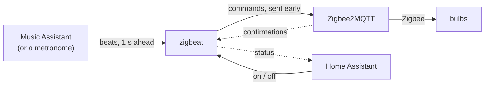

# zigbeat

**Make your Zigbee lights move with your music, without flooding your network.**

Ordinary Zigbee bulbs on [Zigbee2MQTT](https://www.zigbee2mqtt.io/) have no good way to follow music. Spotify closed its audio analysis API, and blasting commands at a few bulbs fills the shared mesh until the lights lag and the rest of the house slows down. zigbeat does the opposite of a strobe: fewer changes, always on the beat, within a budget measured on your own network.

## Status

- **Works today:** `zigbeat probe` measures how many light commands per second your network handles. `zigbeat run` drives your lights within that budget to the beats of the music that [Music Assistant](https://www.music-assistant.io/) plays, or to a fixed-BPM metronome. `zigbeat serve` does the same as a service that Home Assistant switches on and off.
- **In progress:** checking on real speakers that the lights land on the beat by ear.
- **Later:** `zigbeat setup`, a container image.

## What it does

- It follows the beats Music Assistant finds in what it plays, from any of its music sources and on any speaker it plays to.
- Colour bulbs change colour on the beat, a few at a time, with a short brightness kick.
- Dimmable bulbs breathe slowly up and down.
- It stays below the budget the probe found, backs off when the network gets busy and pauses when it keeps struggling. Network trouble never ends the show.
- Every light goes back to how it was when you stop the show, with Ctrl-C or the switch in Home Assistant.
- Home Assistant gets a switch and sensors through MQTT discovery, without any YAML.

It does not flash on every beat, use Zigbee groups, or switch relays and plugs. [DESIGN.md](DESIGN.md) explains why.

## How it works



1. When the show starts, zigbeat reads the state of every light in the config.
2. Music Assistant analyses the music it plays and says when each beat becomes audible. Without it, a metronome at a fixed BPM does.
3. On each moment zigbeat picks a few bulbs and sends their commands early by the latency it measures, so the light lands on the beat. A bulb gets its next command only after Zigbee2MQTT confirmed the previous one.
4. When the show stops, every light goes back to the state from step 1.

Home Assistant only switches the show on and off and reads its status. It stays out of the timing path.

zigbeat is a single static Go binary, meant to run next to Zigbee2MQTT. Architecture, effects, roadmap and decisions: [DESIGN.md](DESIGN.md).

## Measure your network

`zigbeat probe` sends colour commands to a few target bulbs at a rising rate while it watches a far-away **canary** device for the rest of the network. It stops at the first sign of overload: lost commands, rising latency, a slower canary or Zigbee2MQTT errors. The result becomes the engine's budget.

### Install

With Go 1.24 or later:

```bash
go install github.com/siemenvdn/zigbeat/cmd/zigbeat@latest
```

To build for a Raspberry Pi or another machine, see [Build from source](#build-from-source).

### Choose targets and a canary

- **Targets:** two to four colour bulbs (xy colour) that zigbeat will drive later. Mains powered, not behind a switch that might be turned off.
- **Canary:** a mains-powered device as far from the targets as possible, ideally in another room. Not a battery device, because those sleep and answer late. The canary is only read, never changed.

Use Zigbee2MQTT friendly names.

### Run it

Create an MQTT user for zigbeat on your broker. Then, ideally on the same host as the broker:

```bash
export MQTT_USER=zigbeat
read -rs MQTT_PASSWORD && export MQTT_PASSWORD
zigbeat probe -broker 127.0.0.1:1883 -targets pendant-1,pendant-2,pendant-3 -canary hallway-ceiling
```

`zigbeat probe -h` lists all flags.

What you will see:

- The run takes at least 5 minutes, a few more on a strong network. The targets flash in all colours the whole time. Leave them alone, also in Home Assistant.
- At the end every target goes back to its starting state, also after Ctrl-C. A second Ctrl-C quits at once without restoring. The starting state is printed as JSON at the top of the output, so you can restore it by hand.
- Raw samples go to a CSV file.

### Read the result

The probe prints one line per step:

| Column | Meaning |
|---|---|
| `sent`, `ok`, `lost` | Commands sent, confirmed, and unanswered after 5 s |
| `p50`, `p95`, `max` | Time until Zigbee2MQTT confirmed the new state |
| `drift` | Latency kept growing during the step: a queue is building up |
| `canary p95`, `canary lost` | How the rest of the network is doing |
| `z2m err` | Errors Zigbee2MQTT logged during the step |
| `verdict` | `OK`, `WARN` (borderline, repeated once), `STOP` (overloaded) or `PARTIAL` (interrupted) |

The summary gives the highest clean rate, a safe budget (half of it) and the latency at that load.

If `p50` stays below about 20 ms everywhere, Zigbee2MQTT confirmed before the bulb got the command, and the probe measured MQTT instead of the radio. Please [open an issue](https://github.com/siemenvdn/zigbeat/issues) with your output.

## Run the show

### Configure

Copy [`config.example.yaml`](config.example.yaml) to `config.yaml` and fill it in:

- `budget.max_rate`: the suggested budget from the probe. `budget.latency_ms`: the p50 the probe reported at that load. The show will not start without them.
- `fixtures`: your lights, grouped as they hang. Give each fixture a role:
  - `color` for colour bulbs. `mode` decides how a fixture changes: `separate` (one bulb at a time), `together` (the whole fixture at once) or `alternate` (switches between the two every few moments, the default).
  - `breathe` for dimmable bulbs.
- `canary` (optional): a far-away mains-powered device, as for the probe. The show reads it every 5 seconds to watch the rest of the network.
- `effects` (optional): the time between changes, the base brightness, the colour palette and the breathe range.
- `music_assistant` (optional): where the beats come from, see [Play to the music](#play-to-the-music). Without it the show runs to a metronome.

Lights that are not in the config are never touched. List lights one by one: a Zigbee2MQTT group name is refused, because group commands are broadcasts. The MQTT password comes from the environment variable named in `password_env`.

### Start it

```bash
read -rs ZIGBEAT_MQTT_PASSWORD && export ZIGBEAT_MQTT_PASSWORD
zigbeat run -config config.yaml
```

`-bpm 120` plays to a metronome at that tempo instead, also when the config has a `music_assistant` block. zigbeat reads the state of every light, prints it as JSON for a manual restore, measures the canary for 5 seconds and starts. Every 10 seconds it prints a status line:

```
21:14:10  moments 35  dropped 2  frames/s 4.2  in flight 1  p50 38 ms  backoff 0  canary 61 ms  z2m err 0
```

| Field | Meaning |
|---|---|
| `moments` | Moments played so far |
| `dropped` | Moments skipped because they could not land on the beat |
| `frames/s` | Zigbee frames sent, always below `budget.max_rate` |
| `p50` | Time until Zigbee2MQTT confirms, per frame |
| `backoff` | 0 normal, 1 no kick, 2 half as many moments, 3 paused |
| `canary`, `z2m err` | Last canary answer and Zigbee2MQTT errors so far |

Ctrl-C, `kill` or a closed SSH session stops the show and puts every light back, lights that were off included. A second Ctrl-C quits at once without restoring.

### When something goes wrong

The show keeps going and gets calmer instead:

- **The network slows down** (rising latency, lost commands, a slow canary, Zigbee2MQTT errors): the backoff level rises one step at a time. At level 3 the show pauses with the lights in their last colour, and resumes after a quiet minute.
- **A light stops answering**, for example switched off at the wall: after two misses zigbeat leaves it alone, reads it once a minute and takes it back when it answers.
- **The broker goes away**: zigbeat reconnects every 5 seconds and carries on. If it is still gone when you stop the show, zigbeat tries for 30 seconds, then prints the saved state of the lights it could not restore and exits with code 1.
- **A light does not answer at the start**: it is left out with a warning; the show runs with the others.
- **The music stops or Music Assistant goes away**: the lights keep their colour and breathing lights settle at their low end. zigbeat reconnects every 5 seconds and picks up the beats again.

## Play to the music

zigbeat follows the beats that Music Assistant's own analysis finds. It works for music that Music Assistant plays itself, from Spotify, SoundCloud, Apple Music, Tidal, local files or another of its providers, on any speaker it plays to, a Chromecast included. Music that Music Assistant only passes on, such as Spotify Connect into Music Assistant or radio, has no beats.

1. Install [Music Assistant](https://www.music-assistant.io/) 2.10 or later. Its beat analysis recommends 6 GB of RAM and 4 cores.
2. In its settings, add the **Smart Fades** audio analysis and the **MilkDrop Visualizer** plugin.
3. Under Settings, Profile, create a long-lived access token.
4. Add to the config:

   ```yaml
   music_assistant:
     url: ws://music-assistant:8095   # Music Assistant's webserver
     token_env: ZIGBEAT_MA_TOKEN
     player: ""                       # optional: one player's id; empty follows the player that is playing
   ```

5. Check that beats arrive, without touching a light:

   ```bash
   read -rs ZIGBEAT_MA_TOKEN && export ZIGBEAT_MA_TOKEN
   zigbeat beats -config config.yaml
   ```

   Play a track through Music Assistant. After a line such as `412 beats ahead, 124.0 BPM, 103 downbeats` it prints one line per beat when it should sound, such as `21:14:10.500  bar 3 beat 1  124.0 BPM`. The first time a track plays, its beats arrive 5 to 10 seconds after it starts; the analysis is kept for the next time.

`zigbeat run` and `zigbeat serve` then use the same block. Lines starting with `music assistant:` tell what the source does: a new track, the music stopping, a lost connection, a refused token.

### Calibrate the audio offset

TVs, soundbars and amplifiers delay the sound, so the lights need to wait for it. While `zigbeat run` plays, type a line and Enter:

| Line | Effect |
|---|---|
| `+` or `-` | The lights 10 ms later or earlier, per character: `+++` is 30 ms later |
| A number such as `180` | Sets the offset in ms, -500 to 2000 |
| Empty | Prints the current offset |

1. Play a track with a clear kick, for example house around 124 BPM.
2. Watch the brightness jump of a colour bulb: it is instant, the colour blends after it.
3. Find where it starts to look late and where it starts to look early, and type the number halfway.
4. Put it in the config as `budget.audio_offset_ms`; zigbeat prints the line to copy when the show stops.
5. Check with two tracks of another tempo, for example around 90 and 170 BPM.

## Home Assistant

`zigbeat serve` keeps running next to Zigbee2MQTT and adds a **zigbeat** device to Home Assistant through MQTT discovery. No Home Assistant YAML is needed, only the MQTT integration that Zigbee2MQTT already uses.

```bash
read -rs ZIGBEAT_MQTT_PASSWORD && export ZIGBEAT_MQTT_PASSWORD
zigbeat serve -config config.yaml
```

It uses the same config as `zigbeat run`, with the same beat source. The show is off when serve starts, also after a restart. Switch it on in Home Assistant: zigbeat reads every light, plays, and puts every light back when you switch it off. Ctrl-C, `kill` or a closed SSH session stops serve, after a restore when a show is on. Start it with `nohup` to keep it running after you log out.

| Entity | Shows |
|---|---|
| `switch.zigbeat_show` | Starts and stops the show |
| `sensor.zigbeat_status` | `off`, `starting`, `running`, `paused` or `stopping` |
| `sensor.zigbeat_frames_per_second` | Zigbee frames sent, always below `budget.max_rate` |
| `sensor.zigbeat_latency` | Time until Zigbee2MQTT confirms, per frame |
| `sensor.zigbeat_backoff` | 0 normal, 1 no kick, 2 half as many moments, 3 paused |
| `sensor.zigbeat_lights_playing`, `sensor.zigbeat_lights_left_alone` | Lights in the show, and lights from the config that do not answer |

The numbers follow every 10 seconds and are unknown while the show is off. When zigbeat stops or loses its connection, the entities become unavailable.

Next to the Zigbee2MQTT topics, the MQTT user for zigbeat needs write access to `homeassistant/device/zigbeat/config` and `zigbeat/#`, and read access to `zigbeat/show/set`. Run one `zigbeat serve` per broker, and no `zigbeat run` while its show is on.

To remove the device from Home Assistant, stop zigbeat and clear its discovery message:

```bash
mosquitto_pub -r -n -t homeassistant/device/zigbeat/config
```

## Build from source

```bash
go test ./...
CGO_ENABLED=0 GOOS=linux GOARCH=arm64 go build -trimpath -ldflags "-s -w" -o zigbeat ./cmd/zigbeat
```

Try the probe without real lights, against a simulated Zigbee2MQTT that handles about 10 commands per second:

```bash
mosquitto -p 18830 &
go run ./cmd/fake-z2m -broker 127.0.0.1:18830 &
go run ./cmd/zigbeat probe -broker 127.0.0.1:18830 -targets lamp-1,lamp-2,lamp-3 -canary far-lamp \
  -baseline 8s -step 6s -cooldown 2s
```

The probe should report OK up to around 8/s and stop at 10/s.

Run the show against the same simulation with the example config:

```bash
sed 's/1883$/18830/' config.example.yaml > config.yaml
ZIGBEAT_MQTT_PASSWORD=x go run ./cmd/zigbeat run -config config.yaml
```

It should stay at backoff 0 at about 4 frames/s. Restart `fake-z2m` with `-loss 0.1` to watch backoff and lights being left alone, or stop and start `mosquitto` to watch it reconnect.

`zigbeat serve` against the same simulation, with `mosquitto_pub` playing the Home Assistant switch:

```bash
ZIGBEAT_MQTT_PASSWORD=x go run ./cmd/zigbeat serve -config config.yaml &
mosquitto_sub -p 18830 -v -t 'zigbeat/#' &
mosquitto_pub -p 18830 -t zigbeat/show/set -m ON
```

`zigbeat/state` goes from `off` to `starting` and `running`. Publish `OFF` the same way to stop the show and restore the lamps.

`fake-ma` simulates Music Assistant's beats, here three tracks of 30 seconds:

```bash
go run ./cmd/fake-ma -listen 127.0.0.1:18831 -tracks 80:30s,124:30s,172:30s &
sed -e 's/1883$/18830/' -e 's|^# music_assistant:.*|music_assistant:|' -e 's|^#   url: .*|  url: ws://127.0.0.1:18831|' \
  -e 's|^#   token_env: .*|  token_env: ZIGBEAT_MA_TOKEN|' -e '/^#   player: /d' config.example.yaml > config.yaml
ZIGBEAT_MQTT_PASSWORD=x ZIGBEAT_MA_TOKEN=fake-token go run ./cmd/zigbeat run -config config.yaml
```

The beats of each track arrive 6 seconds after it starts, as on a first play in Music Assistant. `fake-ma -h` lists seeks, gaps and a clock offset to try; `fake-z2m -log` prints when each command lands.

Contributor guidelines: [CLAUDE.md](CLAUDE.md).

## License

[GPL-3.0](LICENSE)
