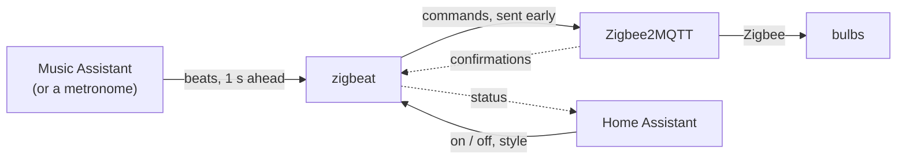

# zigbeat

**Make your Zigbee lights move with your music, without flooding your network.**

Ordinary Zigbee bulbs on [Zigbee2MQTT](https://www.zigbee2mqtt.io/) have no good way to follow music. Spotify closed its audio analysis API, and blasting commands at a few bulbs fills the shared mesh until the lights lag and the rest of the house slows down. zigbeat does the opposite of a strobe: fewer changes, always on the beat, within a budget measured on your own network.

## Status

- **Works today:** `zigbeat setup` finds your lights in Zigbee2MQTT and writes the configuration. `zigbeat probe` measures how many light commands per second your network handles and writes that budget into it. `zigbeat run` drives your lights within that budget to the beats of the music that [Music Assistant](https://www.music-assistant.io/) plays, or to a fixed-BPM metronome. `zigbeat serve` does the same as a service that Home Assistant switches on and off, and whose style it sets: the album colours, the way the bulbs change, the brightness, the pace and the breathe bulbs. It comes as a container image and as binaries for Linux on amd64 and arm64.
- **In progress:** checking on real speakers that the lights land on the beat by ear.
- **Later:** more effects that follow the energy of the music.

## What it does

- It follows the beats Music Assistant finds in what it plays, from any of its music sources and on any speaker it plays to.
- Colour bulbs change colour on the beat, every 2 beats by default, a few at a time, with a short brightness kick. With Music Assistant they take the colours of the album that plays.
- Every 16 bars the colour bulbs change in another way: at the start of a track they fill the room with one colour bulb by bulb, then the colour walks through the room, shuffles, and two groups take turns with a new colour.
- Dimmable bulbs pulse on the beat or flip between high and low in turns, changing between the two every 16 bars.
- With Music Assistant the show follows the energy of the music: in quiet parts, such as a breakdown, the colour bulbs change half as often without a kick and the dimmable bulbs stay low; at a drop everything plays again.
- It stays below the budget the probe found: when a moment holds more than the budget, the white goes first, then the kick, so faster music never makes the lights slower. It backs off when the network gets busy and pauses when it keeps struggling. Network trouble never ends the show.
- Every light goes back to how it was when you stop the show, with Ctrl-C or the switch in Home Assistant.
- Home Assistant gets a switch, controls for the style of the show and sensors through MQTT discovery, without any YAML.

It does not use Zigbee groups or switch relays and plugs. [DESIGN.md](DESIGN.md) explains why.

## How it works



1. When the show starts, zigbeat reads the state of every light in the config.
2. Music Assistant analyses the music it plays and says when each beat becomes audible. Without it, a metronome at a fixed BPM does.
3. On each moment zigbeat picks a few bulbs and sends their commands early by the latency it measures, so the light lands on the beat. A bulb gets its next command only after Zigbee2MQTT confirmed the previous one.
4. When the show stops, every light goes back to the state from step 1.

Home Assistant switches the show on and off, sets its style and reads its status. It stays out of the timing path.

zigbeat is a single static Go binary, meant to run next to Zigbee2MQTT. Architecture, effects, roadmap and decisions: [DESIGN.md](DESIGN.md).

## Set up

### Install

zigbeat runs on Linux, amd64 or arm64, such as a Raspberry Pi 4 or 5 with a 64-bit OS, best on the host of the broker. Pick one way:

- **[Docker compose](#docker-compose)**, when Zigbee2MQTT and Home Assistant run in Docker.
- **[A release binary](#a-release-binary)**, as a systemd service.
- **With Go 1.26 or later:** `go install github.com/siemenvdn/zigbeat/cmd/zigbeat@latest`.

#### Docker compose

In the directory of your `compose.yml`:

1. Make a directory for the config: `mkdir zigbeat`.
2. Put the MQTT password of zigbeat in `.env`, in single quotes when it holds a `$`, and run `chmod 600 .env`:

   ```
   ZIGBEAT_MQTT_PASSWORD=your-password
   ZIGBEAT_MA_TOKEN=your-music-assistant-token
   ```

3. Add the `zigbeat` service of [`compose.example.yml`](compose.example.yml) to `compose.yml`. Set `user` to the output of `id -u` and `id -g`, the owner of `./zigbeat`.
4. Run each `zigbeat` command of this README as `docker compose run --rm zigbeat <command>`; `config.yaml` lands in `./zigbeat`. Find your lights and measure your network first, then start the service:

   ```bash
   docker compose run --rm zigbeat setup
   docker compose run --rm zigbeat probe -config config.yaml
   docker compose up -d zigbeat
   ```

The service runs `zigbeat serve`, which Home Assistant switches on and off. `docker compose stop`, `restart` and `down` put every light back first: `stop_grace_period` gives that a minute, where Docker waits 10 s by default. Update with `docker compose pull zigbeat && docker compose up -d zigbeat`. After adding `stop_grace_period` to a service that already runs, give the first `up -d` `--timeout 60`: the old container still has the 10 s.

zigbeat cannot put the lights back after `docker kill`, a crash or a power cut; `docker compose logs zigbeat` holds their state from before the show (`current state (for manual restore): ...`). At a reboot Docker stops the broker at the same time as zigbeat, so the lights most likely stay as the show left them. A release binary under systemd does not have that problem.

#### A release binary

1. Download the archive for your machine (`uname -m`: `x86_64` is amd64, `aarch64` is arm64) and `checksums.txt` from the [latest release](https://github.com/siemenvdn/zigbeat/releases/latest), then:

   ```bash
   sha256sum -c --ignore-missing checksums.txt
   tar xzf zigbeat_*_linux_arm64.tar.gz zigbeat
   sudo install zigbeat /usr/local/bin/
   ```

2. After [setup](#find-your-lights) and [the probe](#measure-your-network), run `zigbeat serve` as a service. Put the MQTT password in `/etc/zigbeat.env`, as in `.env` above, and run `sudo chmod 600 /etc/zigbeat.env`. Then write `/etc/systemd/system/zigbeat.service`, with your user and the directory of `config.yaml`:

   ```ini
   [Unit]
   Description=zigbeat light show
   Wants=network-online.target
   After=network-online.target docker.service mosquitto.service zigbee2mqtt.service

   [Service]
   User=pi
   WorkingDirectory=/home/pi/zigbeat
   EnvironmentFile=/etc/zigbeat.env
   ExecStart=/usr/local/bin/zigbeat serve
   TimeoutStopSec=60
   Restart=on-failure
   RestartSec=5

   [Install]
   WantedBy=multi-user.target
   ```

3. Start it, also at every boot:

   ```bash
   sudo systemctl daemon-reload
   sudo systemctl enable --now zigbeat
   ```

systemd stops services in the reverse order of `After=`, so at a reboot zigbeat puts every light back before Mosquitto, Zigbee2MQTT or Docker stop. `journalctl -u zigbeat` shows its output.

### An MQTT user for zigbeat

zigbeat logs in to the broker as its own user, `zigbeat` by default.

- **Mosquitto (`eclipse-mosquitto`):** add the user to the `password_file` of `mosquitto.conf`, for example `docker compose exec mosquitto mosquitto_passwd /mosquitto/config/password.txt zigbeat`, and restart the broker. With an `acl_file`, zigbeat needs exactly these lines:

  ```
  user zigbeat
  topic read zigbee2mqtt/#
  topic write zigbee2mqtt/+/set
  topic write zigbee2mqtt/+/get
  topic readwrite zigbeat/#
  topic write homeassistant/device/zigbeat/config
  ```

  A friendly name with a `/` needs `topic write zigbee2mqtt/#` instead of the two `+` lines. Another `base_topic` in Zigbee2MQTT replaces `zigbee2mqtt`.
- **Home Assistant's Mosquitto app:** add a Home Assistant user `zigbeat` under Settings, People, Users. The app does not limit the topics of a user.

### Addresses

| zigbeat runs | Broker (`-broker`, `mqtt.broker`) | Music Assistant (`music_assistant.url`) |
|---|---|---|
| With `compose.example.yml`, on the host of the broker | `127.0.0.1:1883` | `ws://127.0.0.1:8095` |
| As a binary on the host of the broker | `127.0.0.1:1883` | `ws://127.0.0.1:8095` |
| On another machine, next to Home Assistant OS | `<ha-ip>:1883` | `ws://<ha-ip>:8095` |

When Music Assistant runs on yet another machine, use its address: `ws://<ip>:8095`.

### Home Assistant OS

A container next to Home Assistant OS marks the install as unsupported. Run zigbeat on another Linux machine in your network instead, with the addresses above; the Mosquitto app takes connections on port 1883.

### Find your lights

With the [MQTT user](#an-mqtt-user-for-zigbeat) of zigbeat, ideally on the host of the broker:

```bash
read -rsp 'MQTT password for zigbeat: ' ZIGBEAT_MQTT_PASSWORD && echo && export ZIGBEAT_MQTT_PASSWORD
zigbeat setup -broker 127.0.0.1:1883
```

zigbeat reads the device list of Zigbee2MQTT and shows every light it may drive, with a role and a fixture it proposes:

- Colour bulbs (xy colour) get `color`; other dimmable bulbs, white ones included, get `breathe`.
- Relays, plugs, dimmer modules, lights with several channels and anything else that is not a bulb are never offered. The list says why.

Answer which lights take part, such as `1-3,7`, and which device is the **canary**: a mains-powered device far from those lights, ideally in another room. zigbeat watches it to see how the rest of the network is doing; it is only read, never changed. Then zigbeat writes `config.yaml`.

Run `zigbeat setup` again after adding a bulb: it changes only the lights and the canary in the file. `-lights` and `-canary` answer the questions up front; `zigbeat setup -h` lists all flags.

## Measure your network

`zigbeat probe` sends colour commands to the colour lights of the config at a rising rate while it watches the canary. It stops at the first sign of overload: lost commands, rising latency, a slower canary or Zigbee2MQTT errors. The result becomes the show's budget.

### Run it

```bash
zigbeat probe -config config.yaml
```

Without colour lights in the config, it measures the other lights with brightness commands. Without a config, name two to four mains-powered colour bulbs and a canary, with the MQTT user in the environment:

```bash
export MQTT_USER=zigbeat
read -rsp 'MQTT password: ' MQTT_PASSWORD && echo && export MQTT_PASSWORD
zigbeat probe -broker 127.0.0.1:1883 -targets pendant-1,pendant-2,pendant-3 -canary hallway-ceiling
```

`zigbeat probe -h` lists all flags. A target that `zigbeat setup` would not offer, such as a plug, stops the probe before anything changes.

What you will see:

- The run takes at least 5 minutes, a few more on a strong network. The targets flash in all colours the whole time. Leave them alone, also in Home Assistant.
- At the end every target goes back to its starting state, also after Ctrl-C. A second Ctrl-C quits at once without restoring. The starting state is printed as JSON at the top of the output, so you can restore it by hand.
- Raw samples go to a CSV file.
- With `-config`, the budget goes into the config at the end, also after Ctrl-C: `budget written to config.yaml: max_rate 0 -> 15 frames/s, latency_ms 0 -> 66 ms`.

### Read the result

The probe prints one line per step:

| Column | Meaning |
|---|---|
| `sent`, `ok`, `lost` | Commands sent, confirmed, and unanswered after 5 s |
| `p50`, `p95`, `max` | Time until Zigbee2MQTT confirmed the new state |
| `drift` | Latency kept growing during the step: a queue is building up |
| `canary p95`, `canary lost` | How the rest of the network is doing |
| `z2m err` | Errors Zigbee2MQTT logged during the step |
| `verdict` | `OK`, `WARN` (borderline, repeated once), `STOP` (overloaded) or `PARTIAL` (interrupted) |

The summary gives the highest clean rate, a safe budget (half of it) and the latency at that load.

If `p50` stays below about 20 ms everywhere, Zigbee2MQTT confirmed before the bulb got the command, and the probe measured MQTT instead of the radio. Please [open an issue](https://github.com/siemenvdn/zigbeat/issues) with your output.

## Run the show

### Configure

`zigbeat setup` and `zigbeat probe` write `config.yaml`; edit it to change what they chose. [`config.example.yaml`](config.example.yaml) shows every key:

- `budget.max_rate` and `budget.latency_ms`: written by `zigbeat probe -config`. The show will not start without them.
- `fixtures`: your lights, grouped as they hang. Give each fixture a role:
  - `color` for colour bulbs. `mode` decides how a fixture changes: `separate` (one bulb at a time), `together` (the whole fixture at once) or `alternate` (switches between the two every few moments, the default). A fixture of more than three bulbs changes three at a time.
  - `breathe` for dimmable bulbs.
- `canary` (optional): a far-away mains-powered device, as for the probe. The show reads it every 5 seconds to watch the rest of the network.
- `effects` (optional): how many beats between changes (`pace`, 2 by default), the base brightness, the colour palette, the breathe range and how the breathe bulbs move (`breathe_variant`: `rotation`, or always `pulse` or `flip`), whether the album art's colours play and how many (`album_palette`, `album_colors`), how the colour bulbs change (`variant`: `rotation`, or always `walk`, `shuffle`, `swap` or `build`), and whether quiet parts of the music play calmer (`follow_energy`, on by default). A config without these keys plays the album colours and the rotation, also one from before they existed: `album_palette: false` keeps your own `palette`, and `variant: walk` brings back the earlier chase.
- `music_assistant` (optional): where the beats come from, see [Play to the music](#play-to-the-music). Without it the show runs to a metronome.

Lights that are not in the config are never touched. List lights one by one: a Zigbee2MQTT group name is refused, because group commands are broadcasts. At the start, the show also refuses a light that `zigbeat setup` would not offer, such as a plug, and a `color` light without xy colour. The MQTT password comes from the environment variable named in `password_env`.

### Start it

```bash
read -rsp 'MQTT password for zigbeat: ' ZIGBEAT_MQTT_PASSWORD && echo && export ZIGBEAT_MQTT_PASSWORD
zigbeat run -config config.yaml
```

`-bpm 120` plays to a metronome at that tempo instead, also when the config has a `music_assistant` block. zigbeat reads the state of every light, prints it as JSON for a manual restore, measures the canary for 5 seconds and starts. Every 10 seconds it prints a status line:

```
21:14:10  moments 35  dropped 2  frames/s 4.2  in flight 1  p50 38 ms  backoff 0  canary 61 ms  z2m err 0
```

| Field | Meaning |
|---|---|
| `moments` | Moments played so far |
| `dropped` | Colour changes skipped because they could not land on the beat, per light |
| `frames/s` | Zigbee frames sent, always below `budget.max_rate` |
| `p50` | Time until Zigbee2MQTT confirms, per frame |
| `backoff` | 0 normal, 1 no kick, 2 paused |
| `canary`, `z2m err` | Last canary answer and Zigbee2MQTT errors so far |

Ctrl-C, `kill` or a closed SSH session stops the show and puts every light back, lights that were off included. A second Ctrl-C quits at once without restoring.

### What the lights do

The show plays in **moments**: one every `pace` beats (every 2 by default), always on the beat. At a moment at most three colour bulbs change. Per part:

| Part | What you see | Set with |
|---|---|---|
| Colour change | A colour bulb blends to its next colour in 0.7 s, or in half a moment when that is shorter: the album's colours, or `palette` | `album_palette`, `album_colors`, `palette` |
| Kick | With its colour change the bulb jumps 30 % brighter on the beat, and falls back half a moment later | `brightness` (the level it falls back to) |
| `build` | One bulb per moment takes a shared colour until every bulb shows it, then the next colour | `variant` |
| `walk` | About half the bulbs change, walking through the room in the order of the config | `variant` |
| `shuffle` | As many bulbs, in a random order; every bulb once before any comes back | `variant` |
| `swap` | The bulbs in two groups that take turns, each group in one colour, like a checkerboard | `variant` |
| `rotation` | `build` for the first 16 bars of a track, then `walk`, `shuffle` and `swap`, 16 bars each | `variant` (the default) |
| Fixture mode | `separate`: one bulb of a fixture at a time; `together`: the whole fixture at once in one colour; `alternate`: switches between the two every 4 moments | `mode` per fixture |
| `pulse` | The dimmable bulbs jump to the top of `breathe_range` with the kick and fall back to the bottom | `breathe_variant` |
| `flip` | Every other dimmable bulb high, the rest low; they swap at each moment | `breathe_variant` |
| Quiet part | In a breakdown or a quiet verse: half as many moments, no kick, the dimmable bulbs low | `follow_energy` |

Every setting except the fixture mode and the palette is also in Home Assistant. When the network gets busy, the white goes first, then the kick; the colour changes stay. The exact rules are in [DESIGN.md](DESIGN.md#effects).

### When something goes wrong

The show keeps going and gets calmer instead:

- **The network slows down** (rising latency, lost commands, a slow canary, Zigbee2MQTT errors): the backoff level rises one step at a time. At level 2 the show pauses with the lights in their last colour, and resumes after a quiet minute.
- **A light stops answering**, for example switched off at the wall: after two misses zigbeat leaves it alone, reads it once a minute and takes it back when it answers.
- **The broker goes away**: zigbeat reconnects every 5 seconds and carries on. If it is still gone when you stop the show, zigbeat tries for 30 seconds, then prints the saved state of the lights it could not restore and exits with code 1.
- **A light does not answer at the start**: it is left out with a warning; the show runs with the others.
- **The music stops or Music Assistant goes away**: the lights keep their colour and breathing lights settle at their low end. zigbeat reconnects every 5 seconds and picks up the beats again.

## Play to the music

zigbeat follows the beats that Music Assistant's own analysis finds. It works for music that Music Assistant plays itself, from Spotify, SoundCloud, Apple Music, Tidal, local files or another of its providers, on any speaker it plays to, a Chromecast included. Music that Music Assistant only passes on, such as Spotify Connect into Music Assistant or radio, has no beats.

1. Install [Music Assistant](https://www.music-assistant.io/) 2.10 or later. Its beat analysis recommends 6 GB of RAM and 4 cores.
2. In its settings, add the **Smart Fades** audio analysis and the **MilkDrop Visualizer** plugin.
3. Under Settings, Profile, create a long-lived access token.
4. Add to the config:

   ```yaml
   music_assistant:
     url: ws://127.0.0.1:8095         # Music Assistant's webserver, see Addresses
     token_env: ZIGBEAT_MA_TOKEN
     player: ""                       # optional: one player's id; empty follows whichever player is playing
   ```

5. Check that beats arrive, without touching a light:

   ```bash
   read -rsp 'Music Assistant token: ' ZIGBEAT_MA_TOKEN && echo && export ZIGBEAT_MA_TOKEN
   zigbeat beats -config config.yaml
   ```

   Play a track through Music Assistant. After a line such as `412 beats ahead, 124.0 BPM, 103 downbeats` it prints the track with the colours the show would play, such as `track 124.0 BPM, album colours #406cff #ff943d #7340ff (Music Assistant sent 6)`, then one line per beat when it should sound, such as `21:14:10.500  bar 3 beat 1  energy 0.82`. Energy is how loud the coming bar is within the track: 0.50 until the track has had a louder or a quieter part. A bar below 0.30 starts a quiet part of the show, a bar of 0.50 or more ends it. The first time a track plays, its beats arrive 5 to 10 seconds after it starts; the analysis is kept for the next time.

`zigbeat run` and `zigbeat serve` then use the same block. Lines starting with `music assistant:` tell what the source does: a new track, the music stopping, a lost connection, a refused token. During the show, lines such as `album colours #406cff #ff943d #7340ff` and `variant walk from bar 16` say what the lights do.

### Calibrate the audio offset

TVs, soundbars and amplifiers delay the sound, so the lights need to wait for it. While `zigbeat run` plays, type a line and Enter:

| Line | Effect |
|---|---|
| `+` or `-` | The lights 10 ms later or earlier, per character: `+++` is 30 ms later |
| `+30` or `-30` | The lights that many ms later or earlier |
| A number such as `180` | Sets the offset in ms, -500 to 2000 |
| Empty | Prints the current offset |
| `save` | Writes the offset into the config as `budget.audio_offset_ms` |

1. Play a track with a clear kick, for example house around 124 BPM.
2. Watch the brightness jump of a colour bulb: it is instant, the colour blends after it.
3. Find where it starts to look late and where it starts to look early, and type the number halfway.
4. Type `save` to keep it in the config. When the show stops, zigbeat says so if the offset changed after the last `save`.
5. Check with two tracks of another tempo, for example around 90 and 170 BPM.

With `zigbeat serve`, set the offset with **Audio offset** in Home Assistant while the show plays, in steps of 10 ms. Home Assistant keeps it, so after a change of speakers you only set it again there.

## Home Assistant

`zigbeat serve` keeps running next to Zigbee2MQTT and adds a **zigbeat** device to Home Assistant through MQTT discovery. No Home Assistant YAML is needed, only the MQTT integration that Zigbee2MQTT already uses.

```bash
read -rsp 'MQTT password for zigbeat: ' ZIGBEAT_MQTT_PASSWORD && echo && export ZIGBEAT_MQTT_PASSWORD
zigbeat serve -config config.yaml
```

It uses the same config as `zigbeat run`, with the same beat source. The show is off when serve starts, also after a restart. Switch it on in Home Assistant: zigbeat reads every light, plays, and puts every light back when you switch it off. Ctrl-C, `kill` or a closed SSH session stops serve, after a restore when a show is on. To keep it running, install it [with Docker compose](#docker-compose) or [as a systemd service](#a-release-binary).

| Entity | Shows |
|---|---|
| `switch.zigbeat_show` | Starts and stops the show |
| `sensor.zigbeat_status` | `off`, `starting`, `running`, `paused` or `stopping` |
| `sensor.zigbeat_frames_per_second` | Zigbee frames sent, always below `budget.max_rate` |
| `sensor.zigbeat_latency` | Time until Zigbee2MQTT confirms, per frame |
| `sensor.zigbeat_backoff` | 0 normal, 1 no kick, 2 paused |
| `sensor.zigbeat_lights_playing`, `sensor.zigbeat_lights_left_alone` | Lights in the show, and lights from the config that do not answer |

The numbers follow every 10 seconds and are unknown while the show is off. When zigbeat stops or loses its connection, the entities become unavailable.

Next to the switch you set the style of the show, before it starts or while it plays; a change applies from the next moment:

| Entity | Sets | In the config |
|---|---|---|
| `switch.zigbeat_album_colours` | Whether the album art's colours play | `effects.album_palette` |
| `number.zigbeat_album_colour_count` | How many colours, 2 to 6 | `effects.album_colors` |
| `select.zigbeat_variant` | How the colour bulbs change: `rotation`, `walk`, `shuffle`, `swap` or `build` | `effects.variant` |
| `number.zigbeat_brightness` | The base brightness of the colour bulbs, 1 to 100 % | `effects.brightness` |
| `select.zigbeat_pace` | How often the bulbs change: every beat, every 2 beats, every bar, every 2 bars or every 4 bars | `effects.pace` |
| `select.zigbeat_breathe_variant` | How the breathe bulbs move: `rotation`, `pulse` or `flip` | `effects.breathe_variant` |
| `number.zigbeat_breathe_low` | The low end of the breathe bulbs, 1 to 100 % | `effects.breathe_range` |
| `number.zigbeat_breathe_high` | The high end of the breathe bulbs, 1 to 100 %, above the low end | `effects.breathe_range` |
| `switch.zigbeat_follow_energy` | Whether quiet parts of the music play calmer | `effects.follow_energy` |
| `number.zigbeat_audio_offset` | How much later than the beat the lights change, for the delay of TV and speakers: -500 to 2000 ms. See [Calibrate the audio offset](#calibrate-the-audio-offset) | `budget.audio_offset_ms` |

A pace that the budget cannot carry at the tempo that plays gets slower only when even the colour changes without kicks do not fit; `zigbeat run` prints a line when that happens.

A choice stays until you change it in Home Assistant, also when zigbeat or Home Assistant restarts: the broker keeps it, and over its own restart too when it has persistence, as Home Assistant's Mosquitto add-on does. What you never chose comes from `config.yaml`; editing a key there that you chose in Home Assistant changes nothing until you wipe the choice. `zigbeat run` uses only `config.yaml`. To give one setting back to the config, wipe its choice, for example the brightness:

```bash
mosquitto_pub -r -n -t zigbeat/style/brightness/set
```

An older zigbeat kept the pace in seconds on `zigbeat/style/cadence/set`; serve prints the command that wipes it. A config with `effects.cadence` is refused with what to set instead.

Run one `zigbeat serve` per broker, and no `zigbeat run` while its show is on. [An MQTT user for zigbeat](#an-mqtt-user-for-zigbeat) lists the topics it needs.

To remove the device from Home Assistant, stop zigbeat and clear its discovery message and the choices (`cadence` is the pace of an older zigbeat):

```bash
mosquitto_pub -r -n -t homeassistant/device/zigbeat/config
for k in album_palette album_colors variant brightness pace breathe_variant breathe_low breathe_high follow_energy audio_offset_ms cadence; do mosquitto_pub -r -n -t zigbeat/style/$k/set; done
```

## Build from source

```bash
go test ./...
CGO_ENABLED=0 GOOS=linux GOARCH=arm64 go build -trimpath -ldflags "-s -w" -o zigbeat ./cmd/zigbeat
```

The image by hand, for example for a Raspberry Pi; the `Dockerfile` copies the binary from `linux/<arch>/`:

```bash
CGO_ENABLED=0 GOOS=linux GOARCH=arm64 go build -trimpath -ldflags "-s -w" -o linux/arm64/zigbeat ./cmd/zigbeat
docker build --platform linux/arm64 -t zigbeat:dev .
```

`goreleaser release --snapshot --clean` builds the archives into `dist/` and both images into Docker, as a release does, without publishing anything.

Try the probe without real lights, against a simulated Zigbee2MQTT that handles about 10 commands per second:

```bash
mosquitto -p 18830 &
go run ./cmd/fake-z2m -broker 127.0.0.1:18830 &
go run ./cmd/zigbeat probe -broker 127.0.0.1:18830 -targets lamp-1,lamp-2,lamp-3 -canary far-lamp \
  -baseline 8s -step 6s -cooldown 2s
```

The probe should report OK up to around 8/s and stop at 10/s.

`fake-z2m` also simulates a white bulb, a plug, a relay, a dimmer module and a sensor; `fake-z2m -h` lists the kinds. `zigbeat setup` against it offers `lamp-1` to `far-lamp` and refuses the others:

```bash
ZIGBEAT_MQTT_PASSWORD=x go run ./cmd/zigbeat setup -broker 127.0.0.1:18830 -config try.yaml
```

Run the show against the same simulation with the example config:

```bash
sed 's/1883$/18830/' config.example.yaml > config.yaml
ZIGBEAT_MQTT_PASSWORD=x go run ./cmd/zigbeat run -config config.yaml
```

It should stay at backoff 0 at about 3 frames/s: with a budget of 4 the colour bulbs change mostly without their kick, and the breathe bulb flips now and then. Restart `fake-z2m` with `-loss 0.1` to watch backoff and lights being left alone, or stop and start `mosquitto` to watch it reconnect.

`zigbeat serve` against the same simulation, with `mosquitto_pub` playing the Home Assistant switch:

```bash
ZIGBEAT_MQTT_PASSWORD=x go run ./cmd/zigbeat serve -config config.yaml &
mosquitto_sub -p 18830 -v -t 'zigbeat/#' &
mosquitto_pub -p 18830 -t zigbeat/show/set -m ON
```

`zigbeat/state` goes from `off` to `starting` and `running`. Publish `OFF` the same way to stop the show and restore the lamps. Set the style as Home Assistant does, retained: `mosquitto_pub -p 18830 -r -t zigbeat/style/variant/set -m swap` changes the variant from the next moment, and serve takes it again after a restart.

`fake-ma` simulates Music Assistant: the beats, the album colours and the music itself, here three tracks of 30 seconds:

```bash
go run ./cmd/fake-ma -listen 127.0.0.1:18831 -tracks 80:30s,124:30s,172:30s &
sed -e 's/1883$/18830/' -e 's|^# music_assistant:.*|music_assistant:|' -e 's|^#   url: .*|  url: ws://127.0.0.1:18831|' \
  -e 's|^#   token_env: .*|  token_env: ZIGBEAT_MA_TOKEN|' -e '/^#   player: /d' config.example.yaml > config.yaml
ZIGBEAT_MQTT_PASSWORD=x ZIGBEAT_MA_TOKEN=fake-token go run ./cmd/zigbeat run -config config.yaml
```

The beats of each track arrive 6 seconds after it starts, as on a first play in Music Assistant. The first track has a navy cover with an orange title, the second none, the third a red one; each plays an intro, a drop, a silent breakdown and the drop again. `fake-ma -h` lists seeks, gaps, palettes and a clock offset to try; `fake-z2m -log` prints when each command lands.

Contributor guidelines: [CLAUDE.md](CLAUDE.md).

## License

[GPL-3.0](LICENSE)
