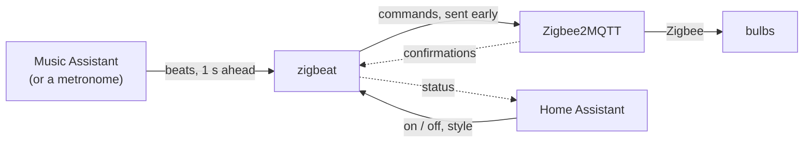

# zigbeat

**Make your Zigbee lights move with your music, without flooding your network.**

Ordinary Zigbee bulbs on [Zigbee2MQTT](https://www.zigbee2mqtt.io/) have no good way to follow music: blasting commands at a few bulbs fills the shared mesh until the lights lag and the rest of the house slows down. zigbeat does the opposite of a strobe: fewer changes, always on the beat, within a budget it measured on your own network.

- **On the beat.** [Music Assistant](https://www.music-assistant.io/) analyses the music it plays and says when each beat sounds; zigbeat sends every command early by the latency it measures, so the light lands on the beat. Any of Music Assistant's sources, on any speaker it plays to. Without it, a metronome at a fixed tempo.
- **The colours of the album.** Colour bulbs take the colours of the cover that plays, a few bulbs at a time with a short brightness kick. Every 16 bars they change in another way: fill the room one by one, walk through it, shuffle, or take turns in two groups.
- **Follows the energy.** Dimmable bulbs pulse or flip with the beat. In a breakdown everything calms down; at the drop it all plays again.
- **Never floods the mesh.** `zigbeat probe` measures what your network handles and the show stays below it: unicast only, one command in flight per bulb, backing off when the network gets busy. No groups, no broadcasts, never a relay or a plug.
- **Home Assistant.** A switch, the style of the show and sensors appear through MQTT discovery. No YAML.
- **Leaves no trace.** Every light goes back to how it was when the show stops, also on Ctrl-C.

## How it works



1. At the start zigbeat reads the state of every light in the config.
2. Music Assistant says when each beat becomes audible, a second ahead.
3. On the beat zigbeat changes a few bulbs, each command sent early by the latency it measures. A bulb gets its next command only after Zigbee2MQTT confirmed the previous one.
4. At the stop every light goes back to the state from step 1.

Home Assistant switches the show on and off and sets its style; it stays out of the timing path. The how and why: [DESIGN.md](DESIGN.md).

## Quick start

You need Zigbee2MQTT and its MQTT broker in Docker compose, on Linux amd64 or arm64: a Raspberry Pi 4 or 5 with a 64-bit OS does. For the music, [Music Assistant](https://www.music-assistant.io/) 2.10 or later.

### 1. An MQTT user

zigbeat logs in to the broker as its own user, `zigbeat`.

- **Mosquitto:** `docker compose exec mosquitto mosquitto_passwd /mosquitto/config/password.txt zigbeat`, then restart the broker. With an `acl_file`, add:

  ```
  user zigbeat
  topic read zigbee2mqtt/#
  topic write zigbee2mqtt/+/set
  topic write zigbee2mqtt/+/get
  topic readwrite zigbeat/#
  topic write homeassistant/device/zigbeat/config
  ```

  Home Assistant's user needs `topic read homeassistant/#` and `topic readwrite zigbeat/#` too.
- **Home Assistant's Mosquitto app:** add a Home Assistant user `zigbeat` under Settings, People, Users.

### 2. Install

In the directory of your `compose.yml`:

1. `mkdir zigbeat` for the config.
2. Put the password, and for the music a Music Assistant token, in `.env` (`chmod 600 .env`; single quotes around a value with a `$`):

   ```
   ZIGBEAT_MQTT_PASSWORD=your-password
   ZIGBEAT_MA_TOKEN=your-music-assistant-token
   ```

3. Add the service of [`compose.example.yml`](compose.example.yml) to `compose.yml`. Set `user` to `id -u` and `id -g`, the owner of `./zigbeat`.

Run every `zigbeat` command below as `docker compose run --rm zigbeat <command>`; `config.yaml` lands in `./zigbeat`. The service runs on the host network, so the broker is at `127.0.0.1:1883` and Music Assistant at `ws://127.0.0.1:8095`; on another machine, give `zigbeat setup` `-broker <ip>:1883` and put Music Assistant's address in the config. A container next to Home Assistant OS marks the install as unsupported: run zigbeat on another Linux machine instead, against `<ha-ip>:1883`. A Home Assistant add-on is on the [ideas list](IDEAS.md).

### 3. Find your lights

```bash
zigbeat setup
```

It reads the device list of Zigbee2MQTT and shows every bulb it may drive: colour bulbs become `color`, other dimmable bulbs `breathe`. Relays, plugs, dimmer modules and anything else that is not a bulb are never offered; the list says why. Answer which lights take part, such as `1-3,7`, and which device is the **canary**: a mains-powered device far from those lights, that zigbeat only reads to see how the rest of the network is doing. It writes `config.yaml`; [`config.example.yaml`](config.example.yaml) explains every key. Run it again after adding a bulb: only the lights and the canary change.

### 4. Measure your network

```bash
zigbeat probe -config config.yaml
```

It sends colour commands to your colour lights at a rising rate while it watches the canary, and stops at the first sign of overload. It takes at least 5 minutes; the lights flash in all colours the whole time, so leave them alone, also in Home Assistant. At the end they go back to how they were and the budget is in the config:

```
budget written to config.yaml: max_rate 0 -> 15 frames/s, latency_ms 0 -> 66 ms
```

### 5. Play

```bash
zigbeat run
```

A show to a metronome at 120 BPM (`-bpm` for another tempo), until Ctrl-C puts every light back. Every 10 seconds it prints a status line; `backoff 0` means the network keeps up. For the music, read on.

## Play to the music

Music Assistant finds the beats in the music it plays itself, from Spotify, Apple Music, Tidal, local files or any other of its providers, on any speaker, a Chromecast included. Music it only passes on, such as Spotify Connect into Music Assistant or radio, has no beats.

1. In Music Assistant, add the **Smart Fades** audio analysis and the **MilkDrop Visualizer** plugin, and create a long-lived token under Settings, Profile. The analysis recommends 6 GB of RAM and 4 cores.
2. Uncomment the `music_assistant` block in `config.yaml`. The token is the `ZIGBEAT_MA_TOKEN` of `.env`.
3. Check that beats arrive, without touching a light, then play:

   ```bash
   zigbeat beats
   zigbeat run
   ```

   The first time a track plays, its beats arrive 5 to 10 seconds in; Music Assistant keeps the analysis for the next time.

**Audio offset.** TVs, soundbars and amplifiers delay the sound, so the lights have to wait for it. While `zigbeat run` plays a track with a clear kick, type `+` or `-` and Enter to move the lights 10 ms later or earlier (`+30` for 30 ms, a number such as `180` sets it), watch the brightness jump of a colour bulb, and type `save` when it lands on the beat. The **Audio offset** slider in Home Assistant does the same, so a change of speakers needs no terminal.

## Home Assistant

```bash
docker compose up -d zigbeat
```

The service runs `zigbeat serve`: it keeps running next to Zigbee2MQTT and adds a **zigbeat** device to Home Assistant through MQTT discovery; the MQTT integration that Zigbee2MQTT already uses is enough.

- A **switch** starts and stops the show. It is off after every start of the service.
- The **style**: the album colours and how many, how the colour bulbs change (`rotation`, `walk`, `shuffle`, `swap` or `build`), the brightness, the pace (every beat to every 4 bars), how the breathe bulbs move and their range, whether quiet parts play calmer, and the audio offset. A change applies from the next change of the bulbs and stays until you change it there; `config.yaml` is the default for what you never chose.
- **Sensors**: status, frames per second, latency, backoff, and the lights playing or left alone.

The entities, the MQTT topics, and how to give a setting back to the config or remove the device: [DESIGN.md](DESIGN.md#home-assistant).

`docker compose stop`, `restart` and `down` put every light back first, with a minute to do it. `docker compose pull zigbeat && docker compose up -d zigbeat` updates. After `docker kill`, a crash or a power cut zigbeat cannot put the lights back; `docker compose logs zigbeat` holds their state from before the show, after `current state (for manual restore)`.

## When something goes wrong

The show gets calmer, never stops. On a slow network it leaves out the kick first and pauses at worst, until a quiet minute has passed. A bulb that stops answering is left alone and taken back when it answers. A lost broker or Music Assistant is dialled again every 5 seconds. Details: [DESIGN.md](DESIGN.md#engine).

## More

- [DESIGN.md](DESIGN.md): the decisions, the effects, the configuration, the probe, the architecture, and how to try everything against a simulated Zigbee2MQTT and Music Assistant.
- [AGENTS.md](AGENTS.md): how work on zigbeat is done, for people and their coding agents.

## License

[GPL-3.0](LICENSE)
